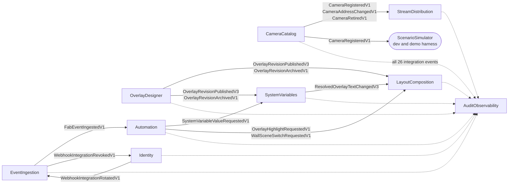

# Domain model

This is the domain model of Smart Sentinel Eye, one page per bounded context. It records what the code
does today: every statement is cited to a source file and line, and anything that could not be established
from code is listed under **Questions** on the page, not asserted.

Decision 016 in [`docs/adr/0000-initial-decisions.md`](../adr/0000-initial-decisions.md) locks **nine**
bounded contexts, and these are exactly the nine documented here. The other `src/` projects
(`ApiGateway`, `ScenarioSimulator`, `AppHost`, `MigrationRunner`, `ServiceDefaults`, `Shared.Kernel`,
`Shared.CQRS`, `Shared.Contracts`) are not bounded contexts; see [Projects without a domain layer](#projects-without-a-domain-layer).

## The nine contexts

| Context | Owns | Page |
|---|---|---|
| CameraCatalog | the registry of cameras: fab, name, RTSP address, in service or retired | [camera-catalog](camera-catalog.md) |
| StreamDistribution | one `Stream` per camera: its MediaMTX path, RTSP source and health | [stream-distribution](stream-distribution.md) |
| LayoutComposition | layout chains (a named grid of camera tiles with revision history) and walls (an ordered set of layouts, one showing) | [layout-composition](layout-composition.md) |
| OverlayDesigner | overlays: a named chain of revisions of up to eight text, box or ellipse elements | [overlay-designer](overlay-designer.md) |
| SystemVariables | named, typed, fab-scoped variables and the resolved overlay text that follows from their values | [system-variables](system-variables.md) |
| EventIngestion | the plant-floor `Event`, the dead-letter quarantine, the event-type registry, per-source mode and the webhook integration registry | [event-ingestion](event-ingestion.md) |
| Automation | the `Rule` aggregate: a per-fab trigger, a predicate and one action | [automation](automation.md) |
| Identity | the `RegisteredClient` aggregate: devices, kiosks and webhook-integration clients | [identity](identity.md) |
| AuditObservability | the audit trail: one immutable row per integration event | [audit-observability](audit-observability.md) |

## How the contexts talk

Contexts share no domain types and no database (ADR-0044). They publish **integration events**: records in
`Shared.Contracts` that implement `IIntegrationEvent`, carry a `V<N>` suffix in their name (ADR-0073) and an
`EventMetadata` envelope (`src/Shared.Contracts/IIntegrationEvent.cs:11`). Each context also raises
in-process **domain events** that never leave it (ADR-0040). Because contexts share no types, each declares
its own copies of the identifiers it needs (see the [glossary](#glossary)).

Every integration event is also recorded by AuditObservability, so the map below draws that as one dotted
line instead of 26 arrows. The solid arrows are the events some other context acts on.



`LayoutComposition` also consumes its own `WallSceneChangedV1` (published and handled in the same context);
that self-loop is in the table, not drawn. `AuditObservability` publishes `AuditChunkArchivedV1` and consumes
it too.

### Every integration event, with who publishes and who acts on it

Generated from the nine context pages (each page cites the publish call and the `Handle` method it read) and
checked to have one publisher per event. "Consumed by" lists contexts other than AuditObservability;
AuditObservability handles all 26 through one class with one overload per event
(`src/AuditObservability/Application/EventHandlers/IntegrationEventAuditHandler.cs:35`).

| Event | Published by | Consumed by | Audited |
|---|---|---|---|
| `AuditChunkArchivedV1` | AuditObservability (`src/AuditObservability/Application/Retention/AuditRetentionHostedService.cs:146`) | none | yes |
| `CameraAddressChangedV1` | CameraCatalog (`src/CameraCatalog/Application/EventHandlers/CameraAddressChangedDomainEventHandler.cs:27`) | StreamDistribution (`src/StreamDistribution/Application/EventHandlers/CameraAddressChangedIntegrationEventHandler.cs:27`) | yes |
| `CameraAddressReadV1` | CameraCatalog (`src/CameraCatalog/Application/Queries/Handlers/GetCameraAddressQueryHandler.cs:53`) | none | yes |
| `CameraRegisteredV1` | CameraCatalog (`src/CameraCatalog/Application/EventHandlers/CameraRegisteredDomainEventHandler.cs:19`) | StreamDistribution (`src/StreamDistribution/Application/EventHandlers/CameraRegisteredIntegrationEventHandler.cs:21`)<br/>ScenarioSimulator (`src/ScenarioSimulator/EventHandlers/CameraRegisteredSimHandler.cs:33`) | yes |
| `CameraRenamedV1` | CameraCatalog (`src/CameraCatalog/Application/EventHandlers/CameraRenamedDomainEventHandler.cs:26`) | none | yes |
| `CameraRetiredV1` | CameraCatalog (`src/CameraCatalog/Application/EventHandlers/CameraRetiredDomainEventHandler.cs:26`) | StreamDistribution (`src/StreamDistribution/Application/EventHandlers/CameraRetiredIntegrationEventHandler.cs:31`) | yes |
| `DeviceRegisteredV1` | Identity (`src/Identity/Application/EventHandlers/ClientRegisteredDomainEventHandler.cs:42`) | none | yes |
| `FabEventIngestedV1` | EventIngestion (`src/EventIngestion/Application/EventHandlers/EventIngestedDomainEventHandler.cs:48`) | Automation (`src/Automation/Application/EventHandlers/FabEventIngestedV1Handler.cs:48`) | yes |
| `KioskEnrolledV1` | Identity (`src/Identity/Application/EventHandlers/ClientRegisteredDomainEventHandler.cs:58`) | none | yes |
| `LayoutRevisionArchivedV1` | LayoutComposition (`src/LayoutComposition/Application/EventHandlers/LayoutRevisionArchivedDomainEventHandler.cs:27`) | none | yes |
| `LayoutRevisionPublishedV2` | LayoutComposition (`src/LayoutComposition/Application/EventHandlers/LayoutRevisionPublishedDomainEventHandler.cs:38`) | none | yes |
| `OverlayHighlightRequestedV1` | Automation (`src/Automation/Application/EventHandlers/FabEventIngestedV1Handler.cs:180`) | LayoutComposition (`src/LayoutComposition/Application/EventHandlers/OverlayHighlightRequestedV1Handler.cs:21`) | yes |
| `OverlayRevisionArchivedV1` | OverlayDesigner (`src/OverlayDesigner/Application/EventHandlers/OverlayRevisionArchivedDomainEventHandler.cs:25`) | LayoutComposition (`src/LayoutComposition/Application/EventHandlers/OverlayRevisionArchivedV1Handler.cs:21`)<br/>SystemVariables (`src/SystemVariables/Application/EventHandlers/OverlayRevisionArchivedV1Handler.cs:18`) | yes |
| `OverlayRevisionPublishedV3` | OverlayDesigner (`src/OverlayDesigner/Application/EventHandlers/OverlayRevisionPublishedDomainEventHandler.cs:31`) | LayoutComposition (`src/LayoutComposition/Application/EventHandlers/OverlayRevisionPublishedV3Handler.cs:25`)<br/>SystemVariables (`src/SystemVariables/Application/EventHandlers/OverlayRevisionPublishedV3Handler.cs:25`) | yes |
| `ResolvedOverlayTextChangedV3` | SystemVariables (`src/SystemVariables/Application/EventHandlers/VariableValueChangedDomainEventHandler.cs:82`) | LayoutComposition (`src/LayoutComposition/Application/EventHandlers/ResolvedOverlayTextChangedV3Handler.cs:24`) | yes |
| `StreamHealthChangedV1` | StreamDistribution (`src/StreamDistribution/Application/EventHandlers/StreamHealthChangedDomainEventHandler.cs:60`) | none | yes |
| `SystemVariableArchivedV1` | SystemVariables (`src/SystemVariables/Application/EventHandlers/VariableArchivedDomainEventHandler.cs:37`) | none | yes |
| `SystemVariableDefinedV1` | SystemVariables (`src/SystemVariables/Application/EventHandlers/VariableDefinedDomainEventHandler.cs:36`) | none | yes |
| `SystemVariableValueChangedV1` | SystemVariables (`src/SystemVariables/Application/EventHandlers/VariableValueChangedDomainEventHandler.cs:40`) | none | yes |
| `SystemVariableValueRequestedV1` | Automation (`src/Automation/Application/EventHandlers/FabEventIngestedV1Handler.cs:164`) | SystemVariables (`src/SystemVariables/Application/EventHandlers/SystemVariableValueRequestedV1Handler.cs:40`) | yes |
| `WallConfiguredV1` | LayoutComposition (`src/LayoutComposition/Application/EventHandlers/WallConfiguredDomainEventHandler.cs:25`) | none | yes |
| `WallSceneChangedV1` | LayoutComposition (`src/LayoutComposition/Application/EventHandlers/WallSceneSwitchedDomainEventHandler.cs:41`) | LayoutComposition (`src/LayoutComposition/Application/EventHandlers/WallSceneChangedV1Handler.cs:26`) | yes |
| `WallSceneSwitchRequestedV1` | Automation (`src/Automation/Application/EventHandlers/FabEventIngestedV1Handler.cs:196`) | LayoutComposition (`src/LayoutComposition/Application/EventHandlers/WallSceneSwitchRequestedV1Handler.cs:37`) | yes |
| `WebhookIntegrationRegisteredV1` | EventIngestion (`src/EventIngestion/Application/EventHandlers/WebhookIntegrationRegisteredDomainEventHandler.cs:28`) | none | yes |
| `WebhookIntegrationRevokedV1` | EventIngestion (`src/EventIngestion/Application/EventHandlers/WebhookIntegrationRevokedDomainEventHandler.cs:29`) | Identity (`src/Identity/Application/EventHandlers/WebhookIntegrationRevokedIntegrationEventHandler.cs:26`) | yes |
| `WebhookIntegrationRotatedV1` | Identity (`src/Identity/Application/Commands/Handlers/RotateWebhookClientCommandHandler.cs:93`) | EventIngestion (`src/EventIngestion/Application/EventHandlers/WebhookIntegrationRotatedV1Handler.cs:19`) | yes |

## Glossary

Terms that mean something different, or have several declarations, across contexts. Each entry points to
the page that defines it.

| Term | Meaning, per context |
|---|---|
| **Fab** | The plant a record belongs to. A deployment serves one or more fabs (ADR-0159). **Eight** contexts each declare their own `FabIdentifier` (all except OverlayDesigner), and the AuditObservability source comment says they mirror the same shape (`src/AuditObservability/Domain/AuditEvent/FabIdentifier.cs:7`): 2 to 32 characters, lowercase letters, digits or `-`, starting with a letter. AuditObservability alone treats it as optional on a row and records why it may be absent in a `FabAttribution` ([audit-observability](audit-observability.md)). |
| **Event** | Four things share the word. A plant-floor `Event` is an ingested record ([event-ingestion](event-ingestion.md)). An `AuditEvent` is an audit row for one integration event ([audit-observability](audit-observability.md)). A **domain event** stays inside its context (ADR-0040). An **integration event** is a `V<N>` contract in `Shared.Contracts` that crosses contexts. |
| **Revision** | A child entity of a chain, with the lifecycle Draft, Published, Archived. Declared twice, as two separate classes: in `Layout` ([layout-composition](layout-composition.md)) and in `Overlay` ([overlay-designer](overlay-designer.md)); ADR-0104 records the duplication. Each chain allows at most one Published revision. |
| **Layout** | In LayoutComposition, the aggregate: a named grid of camera tiles with a revision history. In Automation, `Layout` is only a **variant of `SceneTarget`** that names a layout to switch a wall to, and `LayoutIdentifier` is Automation's own reference type ([automation](automation.md)). LayoutComposition's `Wall` also has a `Layout` variant of its own `SceneTarget`. |
| **Wall and scene** | LayoutComposition owns walls: an ordered set of layouts (scenes), one currently showing ([layout-composition](layout-composition.md)). Automation refers to a wall only by its own `WallIdentifier`. |
| **Scene target** | `SceneTarget` with `Next` or `Layout` is declared in both Automation and LayoutComposition. Automation's source comment says the literals match `WallSceneSwitchRequestedV1.NextTarget` "by agreement, not by any runtime mapping" (`src/Automation/Domain/Rule/SceneTarget.cs:18`). |
| **Rule** | In Automation, the aggregate: a per-fab trigger, a predicate and one action, with the lifecycle Draft, Active, Archived ([automation](automation.md)). In LayoutComposition, `Rule` is only a **variant of `SceneSwitchCause`** (alongside `Operator` and `Reconfigured`) saying an Automation rule caused a scene switch (`src/LayoutComposition/Domain/Wall/SceneSwitchCause.cs:30`). |
| **Overlay** | OverlayDesigner owns the aggregate. Automation and LayoutComposition each declare their own `OverlayIdentifier` to refer to one. |
| **Camera** | CameraCatalog owns the aggregate. StreamDistribution and LayoutComposition each declare their own `CameraIdentifier`. |
| **Variable** | SystemVariables owns the named, typed, fab-scoped aggregate ([system-variables](system-variables.md)). |
| **Client** | In Identity, a `RegisteredClient` of kind `Device`, `Kiosk` or `WebhookIntegration` ([identity](identity.md)). EventIngestion's `WebhookIntegration` is a separate, fab-owned registry aggregate (ADR-0174) linked to Identity only through integration events. |
| **Registration, RegisteredAt, Creation, CreatedAt** | Small value objects redeclared per context (CameraCatalog, EventIngestion and Identity for the first two; Automation, LayoutComposition, OverlayDesigner and SystemVariables for the second pair). They carry no shared meaning beyond "who and when". |

## Projects without a domain layer

- **ApiGateway** is a single YARP reverse proxy at the edge in front of the contexts' APIs (ADR-0106).
  `src/ApiGateway/Program.cs:53` registers the proxy and `:89` maps it; CORS is configured at `:12` and rate
  limiting at `:31`. ADR-0106 also assigns TLS termination to this edge; that part is not visible in
  `Program.cs`. It holds no domain model.
- **ScenarioSimulator** is a development and demonstration harness (ADR-0111, ADR-0163). It provisions
  simulated camera paths driven by the camera catalog and consumes `CameraRegisteredV1`
  (`src/ScenarioSimulator/EventHandlers/CameraRegisteredSimHandler.cs:33`). It also publishes simulated
  billet sensor samples to the Mosquitto broker as a dev-only device (`src/ScenarioSimulator/Mqtt/MqttPublisher.cs:13`),
  plays clip cues on a timeline (`src/ScenarioSimulator/Cues/ClipCueHostedService.cs`), and seeds layouts,
  overlays, variables and rules through the other contexts' APIs (`src/ScenarioSimulator/Seeding/ScenarioSeeder.cs`).
  It holds no domain model and consumes no other integration event. Its design history is in
  [scenario-simulator-m2](../design/scenario-simulator-m2.md).
- `AppHost`, `MigrationRunner`, `ServiceDefaults`, `Shared.Kernel`, `Shared.CQRS` and `Shared.Contracts` are
  composition, tooling or shared plumbing. `Shared.Contracts` holds the integration events above;
  `Shared.Kernel` holds language-level types only (ADR-0044).

## Keeping this honest

`scripts/domain-docs-trace.mjs` checks that every public or internal type under `src/<Context>/Domain/` is
named on its context's page (or listed under **Omitted** with a reason) and that every cited source path and
line exists. It runs in `pnpm test:guards`, so a pull request that adds, renames or removes a Domain type
without updating its page fails there. The check proves a type is *mentioned* and a citation *resolves*; it
cannot prove a description is *right*, which is what review is for.

```text
node scripts/domain-docs-trace.mjs [--context <Name>] [--verbose]
```
