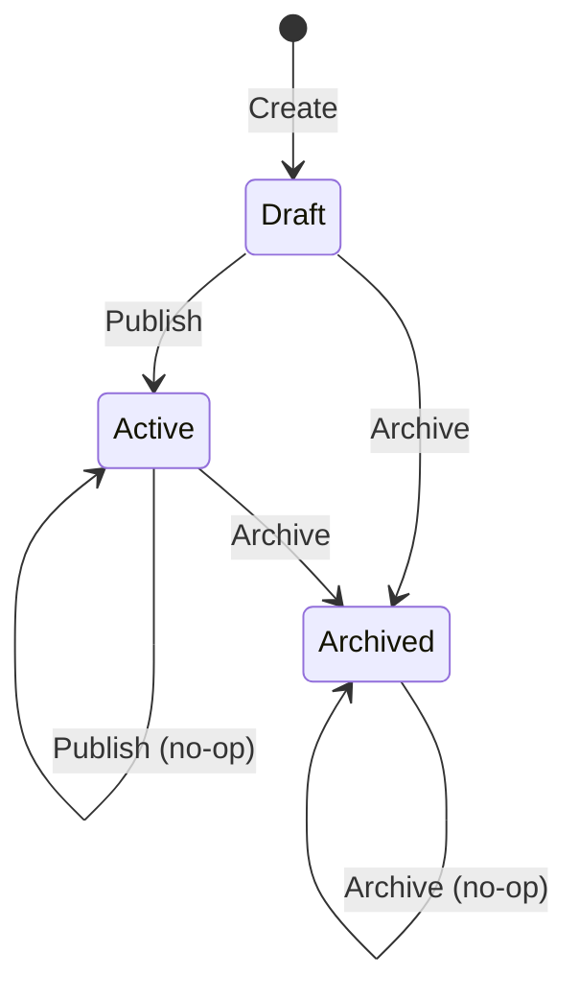

# Automation domain model

**Source:** `src/Automation/Domain/` (and the Application layer only where it shows publishing/consuming of integration events).

## Purpose

Automation owns the `Rule` aggregate: a per-fab trigger (event source and kind), a predicate and one action, with a Draft, Active, Archived lifecycle. It does not own the effects of an action (variable values, overlay highlights, wall scenes); it only publishes requests that other contexts act on.

## Aggregates

### `Rule`

- Identifier: `RuleIdentifier` (Guid v7, minted in `Rule.Create`) — `src/Automation/Domain/Rule/Rule.cs:79`, `src/Automation/Domain/Rule/RuleIdentifier.cs:11`.
- Base type: `AggregateRoot<RuleIdentifier>` — `src/Automation/Domain/Rule/Rule.cs:19`.
- Other state: `Fab`, `Name`, `TriggerSource`, `TriggerKind`, `Predicate`, `Action`, `State`, `Creation`, optional `PublishedAt`, optional `ArchivedAt` — `src/Automation/Domain/Rule/Rule.cs:32`.

**Lifecycle** (states are the `RuleState` values `Draft`, `Active`, `Archived`, `src/Automation/Domain/Rule/RuleState.cs:13`):

| Transition | Rule | Citation |
|---|---|---|
| Create → Draft | A new rule starts in `RuleState.Draft` and raises `RuleCreatedDomainEvent`. | `src/Automation/Domain/Rule/Rule.cs:86`, `src/Automation/Domain/Rule/Rule.cs:89` |
| Draft → Active | `Publish` sets Active, stamps `PublishedAt`, raises `RulePublishedDomainEvent`. | `src/Automation/Domain/Rule/Rule.cs:110` |
| Active → Active | `Publish` on Active returns without effect or event. | `src/Automation/Domain/Rule/Rule.cs:101` |
| Archived → Active | Not allowed: `Publish` on Archived throws `InvalidOperationException`. | `src/Automation/Domain/Rule/Rule.cs:106` |
| Draft or Active → Archived | `Archive` sets Archived, stamps `ArchivedAt`, raises `RuleArchivedDomainEvent`. | `src/Automation/Domain/Rule/Rule.cs:128` |
| Archived → Archived | `Archive` on Archived returns without effect or event. | `src/Automation/Domain/Rule/Rule.cs:123` |

No method returns a rule to Draft; the type's doc comment says the way back is to clone the rule (`src/Automation/Domain/Rule/Rule.cs:9`).

**Invariants**

- `Create` requires non-null fab, name, predicate, action, clock, trigger source and trigger kind — `src/Automation/Domain/Rule/Rule.cs:68`.
- A rule belongs to one fab fixed at creation; `Fab` has a private setter and no method changes it — `src/Automation/Domain/Rule/Rule.cs:32`.
- The trigger source and kind are stored as value objects wrapping plain strings, not as EventIngestion types (context isolation) — `src/Automation/Domain/Rule/Rule.cs:36`.
- An Archived rule cannot be published — `src/Automation/Domain/Rule/Rule.cs:106`.
- `Publish` and `Archive` are idempotent and raise no second event — `src/Automation/Domain/Rule/Rule.cs:101`, `src/Automation/Domain/Rule/Rule.cs:123`.

**Domain events raised:** `RuleCreatedDomainEvent`, `RulePublishedDomainEvent`, `RuleArchivedDomainEvent` (see below).

## Value objects

| Name | Wraps | Rule enforced | Citation |
|---|---|---|---|
| `RuleIdentifier` | `Guid` | Non-empty; `New()` mints a v7 Guid | `src/Automation/Domain/Rule/RuleIdentifier.cs:15` |
| `FabIdentifier` | `string` | 2 to 32 chars, lowercase letters, digits or `-`, starts with a letter | `src/Automation/Domain/Rule/FabIdentifier.cs:73` |
| `RuleName` | `string` | 2 to 63 chars, lowercase letters, digits or `-`, starts with a lowercase letter | `src/Automation/Domain/Rule/RuleName.cs:21` |
| `TriggerSource` | `string` | Not blank, at most 16 chars | `src/Automation/Domain/Rule/TriggerSource.cs:28` |
| `TriggerKind` | `string` | Not blank, at most 128 chars | `src/Automation/Domain/Rule/TriggerKind.cs:26` |
| `RulePredicate` | `string` | 1 to 4096 chars, not blank (source text compiled elsewhere) | `src/Automation/Domain/Rule/RulePredicate.cs:25` |
| `RuleState` | `string` | Only `Draft`, `Active`, `Archived`; anything else throws | `src/Automation/Domain/Rule/RuleState.cs:19` |
| `RuleAction` | abstract base of three variants | Discriminated value; variants below | `src/Automation/Domain/Rule/RuleAction.cs:22` |
| `SetVariableValue` | variable name, value expression | Name not blank, at most 64; expression not blank, at most 4096 | `src/Automation/Domain/Rule/RuleAction.cs:38` |
| `HighlightOverlay` | `OverlayIdentifier`, `HighlightDuration` | Delegates to both value objects' guards | `src/Automation/Domain/Rule/RuleAction.cs:57` |
| `SwitchWallScene` | `WallIdentifier`, `SceneTarget` | `Next` target must not carry a layout; `Layout` target requires one; other target text is rejected | `src/Automation/Domain/Rule/RuleAction.cs:84` |
| `SceneTarget` | abstract base | Closed hierarchy (private constructor): `Next` or `Layout` | `src/Automation/Domain/Rule/SceneTarget.cs:28` |
| `Next` | none | Scene target meaning "next scene" | `src/Automation/Domain/Rule/SceneTarget.cs:30` |
| `Layout` | `LayoutIdentifier` | Scene target naming a layout | `src/Automation/Domain/Rule/SceneTarget.cs:32` |
| `OverlayIdentifier` | `Guid` | Non-empty | `src/Automation/Domain/Rule/OverlayIdentifier.cs:37` |
| `LayoutIdentifier` | `Guid` | Non-empty | `src/Automation/Domain/Rule/LayoutIdentifier.cs:22` |
| `WallIdentifier` | `Guid` | Non-empty | `src/Automation/Domain/Rule/WallIdentifier.cs:23` |
| `HighlightDuration` | `int` milliseconds | In range 500 to 60 000 | `src/Automation/Domain/Rule/HighlightDuration.cs:26` |
| `Creation` | `CreatedAt`, `OperatorIdentifier` | `At` not null | `src/Automation/Domain/Rule/Creation.cs:27` |
| `CreatedAt`, `PublishedAt`, `ArchivedAt` | `DateTimeOffset` | Normalised to UTC in `From`; comparable (one row, all three named) | `src/Automation/Domain/Rule/ArchivedAt.cs:36`, `src/Automation/Domain/Rule/CreatedAt.cs:36`, `src/Automation/Domain/Rule/PublishedAt.cs:36` |

## Domain events

In-process only (ADR-0040).

| Event | Raised by | When | Citation |
|---|---|---|---|
| `RuleCreatedDomainEvent` | `Rule.Create` | A rule is created in Draft | `src/Automation/Domain/Rule/Rule.cs:89` |
| `RulePublishedDomainEvent` | `Rule.Publish` | Draft becomes Active | `src/Automation/Domain/Rule/Rule.cs:112` |
| `RuleArchivedDomainEvent` | `Rule.Archive` | Draft or Active becomes Archived | `src/Automation/Domain/Rule/Rule.cs:130` |

## Integration events

Automation has no folder under `src/Shared.Contracts`. The three request contracts it uses sit in the folders of the contexts that act on them. Direction was established by reading the publish calls and `Handle(...)` methods below.

**Published** (Automation is the publisher of all three; `FabEventIngestedV1Handler` calls `events.PublishAsync` once per effect)

| Event | Contract file | Publishing code |
|---|---|---|
| `SystemVariableValueRequestedV1` | `src/Shared.Contracts/SystemVariables/SystemVariableValueRequestedV1.cs` | `src/Automation/Application/EventHandlers/FabEventIngestedV1Handler.cs:164` |
| `OverlayHighlightRequestedV1` | `src/Shared.Contracts/LayoutComposition/OverlayHighlightRequestedV1.cs` | `src/Automation/Application/EventHandlers/FabEventIngestedV1Handler.cs:180` |
| `WallSceneSwitchRequestedV1` | `src/Shared.Contracts/LayoutComposition/WallSceneSwitchRequestedV1.cs` | `src/Automation/Application/EventHandlers/FabEventIngestedV1Handler.cs:196` |

For orientation (outside Automation), their handlers are `src/SystemVariables/Application/EventHandlers/SystemVariableValueRequestedV1Handler.cs:40`, `src/LayoutComposition/Application/EventHandlers/OverlayHighlightRequestedV1Handler.cs:21` and `src/LayoutComposition/Application/EventHandlers/WallSceneSwitchRequestedV1Handler.cs:37`. `src/AuditObservability/Application/EventHandlers/IntegrationEventAuditHandler.cs:55` also handles the first, `:48` the second and `:60` the third.

**Consumed**

| Event | Contract file | Handler |
|---|---|---|
| `FabEventIngestedV1` | `src/Shared.Contracts/EventIngestion/FabEventIngestedV1.cs` | `src/Automation/Application/EventHandlers/FabEventIngestedV1Handler.cs:48` |

## Repositories and services

- `IRuleRepository` — fetch a rule by `RuleIdentifier` or by fab plus `RuleName` (both return `Option<Rule>`), `Add`, and `SaveAsync` — `src/Automation/Domain/Rule/IRuleRepository.cs:20`, `src/Automation/Domain/Rule/IRuleRepository.cs:28`, `src/Automation/Domain/Rule/IRuleRepository.cs:30`.

No domain services exist in the Domain layer.

## Omitted

None.

## Questions

- The `SceneTarget` doc comment says `Next` / `Layout` literals match `WallSceneSwitchRequestedV1.NextTarget` "by agreement, not by any runtime mapping" (`src/Automation/Domain/Rule/SceneTarget.cs:18`). I did not check the contract's constant, so the agreement itself is unverified here.
- `Publish`/`Archive` on invalid transitions throw `InvalidOperationException`, while the bad-input guards throw `ArgumentException`; how the Api layer maps these was not read.
- Only the three request events above were checked for direction. Whether Automation publishes any other integration event was not established beyond a grep of `src/Automation` for `PublishAsync`, which showed only those three calls.
