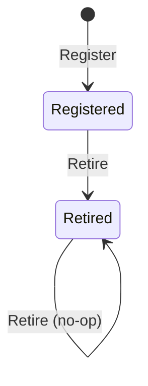
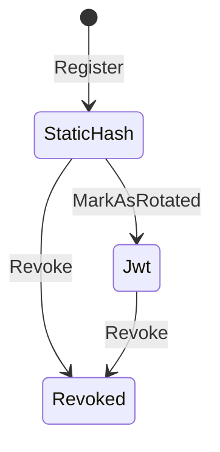

# EventIngestion domain model

**Source:** `src/EventIngestion/Domain/` (and the Application layer only where it shows publishing/consuming of integration events).

## Purpose

EventIngestion owns the fab-scoped plant-floor `Event` record, the quarantine of rejected deliveries (`DeadLetter`), the per-fab registry of accepted event kinds (`RegisteredEventType`), the per-source strict/discovery mode (`SourceMode`), and the webhook integration registry (`WebhookIntegration`, fab-owned per ADR-0174). It does not own rule evaluation, audit storage or the Keycloak clients behind a rotated webhook credential; those are reached only through integration events.

## Aggregates

Every aggregate derives from `AggregateRoot<TIdentifier>` and has a private constructor plus a static factory, so state is only reachable through the factory and the methods below. Identifiers are strongly-typed `Guid` records created with `Guid.CreateVersion7()`.

### `Event`

- Identifier: `EventIdentifier` (`src/EventIngestion/Domain/Event/EventIdentifier.cs:14`). Unlike the other aggregates, `Ingest` takes the identifier from the caller (`src/EventIngestion/Domain/Event/Event.cs:40`).
- Lifecycle: none. An `Event` is created once by `Event.Ingest` and has no mutating method (`src/EventIngestion/Domain/Event/Event.cs:39`).
- Invariants:
  - Every argument (fab, source, device, kind, occurredAt, payload, clock) must be non-null (`src/EventIngestion/Domain/Event/Event.cs:49`).
  - `OccurredAt` may not be more than `MaximumFutureSkew` (5 minutes) ahead of the clock; otherwise `ArgumentException` (`src/EventIngestion/Domain/Event/Event.cs:58`, constant at `src/EventIngestion/Domain/Event/Event.cs:21`).
  - `IngestedAt` is set from the clock at ingest, not supplied by the caller (`src/EventIngestion/Domain/Event/Event.cs:66`).
- Raises: `EventIngestedDomainEvent` (`src/EventIngestion/Domain/Event/Event.cs:78`).

### `DeadLetter`

- Identifier: `DeadLetterIdentifier` (`src/EventIngestion/Domain/DeadLetter/DeadLetterIdentifier.cs:8`), generated inside `Capture` (`src/EventIngestion/Domain/DeadLetter/DeadLetter.cs:102`).
- Lifecycle: `DeadLetter.Capture` always creates the row in `HoldState.Held` (`src/EventIngestion/Domain/DeadLetter/DeadLetter.cs:109`). `HoldState.Promoted` exists as a value (`src/EventIngestion/Domain/DeadLetter/HoldState.cs:16`), but the aggregate has no method that sets it; the only promoting operation in the Domain layer is the bulk repository method `PromoteHeldAsync` (`src/EventIngestion/Domain/DeadLetter/IDeadLetterRepository.cs:19`). See Questions.
- Invariants:
  - Topic, raw payload, error, reason and clock must be non-null (`src/EventIngestion/Domain/DeadLetter/DeadLetter.cs:79`).
  - A dead letter whose reason is `DeadLetterReason.UnknownEventType` must carry a fab (`src/EventIngestion/Domain/DeadLetter/DeadLetter.cs:87`) and a kind (`src/EventIngestion/Domain/DeadLetter/DeadLetter.cs:93`); otherwise `ArgumentException`.
  - For other reasons `Fab` and `Kind` may be null (`src/EventIngestion/Domain/DeadLetter/DeadLetter.cs:32`, `src/EventIngestion/Domain/DeadLetter/DeadLetter.cs:47`). The `Fab` doc comment states a malformed address has no plant and none is invented.
- Raises: no domain events.

### `RegisteredEventType`

- Identifier: `RegisteredEventTypeIdentifier` (`src/EventIngestion/Domain/RegisteredEventType/RegisteredEventTypeIdentifier.cs:14`).
- Lifecycle (`RegistrationState`):

  - `Register` creates the aggregate as `Registered` (`src/EventIngestion/Domain/RegisteredEventType/RegisteredEventType.cs:44`).
  - `Retire` moves it to `Retired` (`src/EventIngestion/Domain/RegisteredEventType/RegisteredEventType.cs:66`). There is no transition back to `Registered` in the aggregate.
- Invariants:
  - Fab, kind and clock must be non-null in `Register` (`src/EventIngestion/Domain/RegisteredEventType/RegisteredEventType.cs:33`).
  - `Retire` is idempotent: retiring an already retired type returns without raising an event (`src/EventIngestion/Domain/RegisteredEventType/RegisteredEventType.cs:61`).
- Raises: `EventTypeRegisteredDomainEvent` (`src/EventIngestion/Domain/RegisteredEventType/RegisteredEventType.cs:48`), `EventTypeRetiredDomainEvent` (`src/EventIngestion/Domain/RegisteredEventType/RegisteredEventType.cs:67`).

### `SourceMode`

- Identifier: `SourceModeIdentifier` (`src/EventIngestion/Domain/SourceMode/SourceModeIdentifier.cs:14`).
- Lifecycle: a declaration of an `EventTypeMode` (strict or discovery) for a (fab, source) pair. `Declare` creates it (`src/EventIngestion/Domain/SourceMode/SourceMode.cs:40`), `Change` swaps the mode (`src/EventIngestion/Domain/SourceMode/SourceMode.cs:71`), and `Undeclare` only raises an event and leaves the row to be removed through `ISourceModeRepository.Remove` (`src/EventIngestion/Domain/SourceMode/SourceMode.cs:87`, `src/EventIngestion/Domain/SourceMode/ISourceModeRepository.cs:23`).
- Invariants:
  - Fab, source, mode and clock must be non-null in `Declare` (`src/EventIngestion/Domain/SourceMode/SourceMode.cs:33`).
  - `Change` is idempotent: setting the current mode returns without an event (`src/EventIngestion/Domain/SourceMode/SourceMode.cs:64`).
  - `Change` replaces the `Declaration` (time and operator) as well as the mode (`src/EventIngestion/Domain/SourceMode/SourceMode.cs:72`).
- Raises: `SourceModeDeclaredDomainEvent` (`src/EventIngestion/Domain/SourceMode/SourceMode.cs:49`), `SourceModeChangedDomainEvent` (`src/EventIngestion/Domain/SourceMode/SourceMode.cs:74`), `SourceModeUndeclaredDomainEvent` (`src/EventIngestion/Domain/SourceMode/SourceMode.cs:87`).

### `WebhookIntegration`

- Identifier: `WebhookIntegrationIdentifier` (`src/EventIngestion/Domain/WebhookIntegration/WebhookIntegrationIdentifier.cs:13`).
- Lifecycle:

  - `Register` starts in `BearerValidationMode.StaticHash` (default at `src/EventIngestion/Domain/WebhookIntegration/WebhookIntegration.cs:47`) with `RevokedAt` null (`src/EventIngestion/Domain/WebhookIntegration/WebhookIntegration.cs:89`).
  - `MarkAsRotated` sets `BearerValidationMode.Jwt`, the Keycloak client and `RotatedAt` (`src/EventIngestion/Domain/WebhookIntegration/WebhookIntegration.cs:128`).
  - `Revoke` sets `RevokedAt` (`src/EventIngestion/Domain/WebhookIntegration/WebhookIntegration.cs:106`). Revocation is a flag (`IsRevoked`, `src/EventIngestion/Domain/WebhookIntegration/WebhookIntegration.cs:96`), orthogonal to the validation mode; the aggregate has no method that undoes it. The diagram models it as a terminal state for clarity.
- Invariants:
  - Name, fab, default kind and clock must be non-null in `Register` (`src/EventIngestion/Domain/WebhookIntegration/WebhookIntegration.cs:74`).
  - The plaintext bearer token is returned once from `Register` and only its hash is stored (`src/EventIngestion/Domain/WebhookIntegration/WebhookIntegration.cs:79`, `src/EventIngestion/Domain/WebhookIntegration/WebhookIntegration.cs:93`).
  - The integration belongs to a fab, fixed at registration (`src/EventIngestion/Domain/WebhookIntegration/WebhookIntegration.cs:85`); ADR-0174 records the decision (`docs/adr/0174-the-webhook-integration-registry-is-fab-owned.md:33`).
  - `Revoke` is idempotent (`src/EventIngestion/Domain/WebhookIntegration/WebhookIntegration.cs:101`).
  - `MarkAsRotated` is idempotent only when the integration is already `Jwt` with the same Keycloak client; a different client id re-rotates (`src/EventIngestion/Domain/WebhookIntegration/WebhookIntegration.cs:122`).
- Raises: `WebhookIntegrationRegisteredDomainEvent` (`src/EventIngestion/Domain/WebhookIntegration/WebhookIntegration.cs:91`), `WebhookIntegrationRevokedDomainEvent` (`src/EventIngestion/Domain/WebhookIntegration/WebhookIntegration.cs:107`), `WebhookIntegrationRotatedDomainEvent` (`src/EventIngestion/Domain/WebhookIntegration/WebhookIntegration.cs:131`).

## Value objects

Guards below are the `Ensure.That(...)` or explicit throw in the `From` factory. Identifier records (`EventIdentifier`, `DeadLetterIdentifier`, `RegisteredEventTypeIdentifier`, `SourceModeIdentifier`, `WebhookIntegrationIdentifier`) wrap a `Guid`, reject `Guid.Empty` in `From`, and expose `New()` for a v7 Guid; the aggregates are described above.

| Name | Wraps | Rule enforced | Citation |
|---|---|---|---|
| `EventIdentifier` | `Guid` | non-empty | `src/EventIngestion/Domain/Event/EventIdentifier.cs:18` |
| `DeadLetterIdentifier` | `Guid` | non-empty | `src/EventIngestion/Domain/DeadLetter/DeadLetterIdentifier.cs:12` |
| `RegisteredEventTypeIdentifier` | `Guid` | non-empty | `src/EventIngestion/Domain/RegisteredEventType/RegisteredEventTypeIdentifier.cs:18` |
| `SourceModeIdentifier` | `Guid` | non-empty | `src/EventIngestion/Domain/SourceMode/SourceModeIdentifier.cs:18` |
| `WebhookIntegrationIdentifier` | `Guid` | non-empty | `src/EventIngestion/Domain/WebhookIntegration/WebhookIntegrationIdentifier.cs:17` |
| `FabIdentifier` | string | 2 to 32 characters, lowercase ASCII letters, digits or `-`, first character a lowercase letter | `src/EventIngestion/Domain/Event/FabIdentifier.cs:65` |
| `DeviceIdentifier` | string | non-blank, at most 64 characters, alphanumeric or `.` `_` `-`, starts with a letter or digit | `src/EventIngestion/Domain/Event/DeviceIdentifier.cs:20` |
| `Kind` | string | non-blank, at most 128 characters, starts with an uppercase ASCII letter, letters or digits only | `src/EventIngestion/Domain/Event/Kind.cs:21` |
| `Source` | string | closed set: `plc`, `inference`, `manual`, `webhook` | `src/EventIngestion/Domain/Event/Source.cs:21` |
| `Payload` | canonical JSON string | valid JSON, at most 65536 bytes (64 KiB), present | `src/EventIngestion/Domain/Event/Payload.cs:32` |
| `OccurredAt` | `DateTimeOffset` | normalised to UTC | `src/EventIngestion/Domain/Event/OccurredAt.cs:34` |
| `IngestedAt` | `DateTimeOffset` | normalised to UTC | `src/EventIngestion/Domain/Event/IngestedAt.cs:33` |
| `DeliveryTopic` | string | non-blank, at most 256 characters; `ForEnvelope` builds `event/{fab}/{source}/{device}` | `src/EventIngestion/Domain/DeadLetter/DeliveryTopic.cs:26` |
| `RawPayload` | string | non-null only (may be malformed JSON; it stores rejected input) | `src/EventIngestion/Domain/DeadLetter/RawPayload.cs:56` |
| `RejectionReason` | string | non-blank, at most 512 characters | `src/EventIngestion/Domain/DeadLetter/RejectionReason.cs:25` |
| `DeadLetterReason` | string | closed set: `ParseFailure`, `Refused`, `UnknownEventType` | `src/EventIngestion/Domain/DeadLetter/DeadLetterReason.cs:19` |
| `HoldState` | string | closed set: `Held`, `Promoted` | `src/EventIngestion/Domain/DeadLetter/HoldState.cs:18` |
| `RejectedAt` | `DateTimeOffset` | normalised to UTC | `src/EventIngestion/Domain/DeadLetter/RejectedAt.cs:36` |
| `RegistrationState` | string | closed set: `Registered`, `Retired` | `src/EventIngestion/Domain/RegisteredEventType/RegistrationState.cs:16` |
| `Registration` | `RegisteredAt` plus `OperatorIdentifier` | registered-at non-null (the operator identifier type comes from outside this context's Domain folder) | `src/EventIngestion/Domain/RegisteredEventType/Registration.cs:14` |
| `RegisteredAt` (RegisteredEventType) | `DateTimeOffset` | normalised to UTC | `src/EventIngestion/Domain/RegisteredEventType/RegisteredAt.cs:37` |
| `EventTypeMode` | string | closed set: `strict`, `discovery` | `src/EventIngestion/Domain/SourceMode/EventTypeMode.cs:19` |
| `Declaration` | `DeclaredAt` plus `OperatorIdentifier` | declared-at non-null | `src/EventIngestion/Domain/SourceMode/Declaration.cs:15` |
| `DeclaredAt` | `DateTimeOffset` | normalised to UTC | `src/EventIngestion/Domain/SourceMode/DeclaredAt.cs:35` |
| `WebhookIntegrationName` | string | non-blank, at most 63 characters, lowercase ASCII letters, digits or `-`, starts with a letter | `src/EventIngestion/Domain/WebhookIntegration/WebhookIntegrationName.cs:20` |
| `BearerTokenHash` | base64 SHA-256 string | generated from 32 random bytes; `Matches` compares with `CryptographicOperations.FixedTimeEquals`; `ToString` never prints the hash | `src/EventIngestion/Domain/WebhookIntegration/BearerTokenHash.cs:26` |
| `BearerValidationMode` | enum | `StaticHash` (0) or `Jwt` (1) | `src/EventIngestion/Domain/WebhookIntegration/BearerValidationMode.cs:15` |
| `KeycloakClientIdentifier` | string | non-blank, at most 255 characters | `src/EventIngestion/Domain/WebhookIntegration/KeycloakClientIdentifier.cs:26` |
| `RegisteredAt` (WebhookIntegration) | `DateTimeOffset` | normalised to UTC | `src/EventIngestion/Domain/WebhookIntegration/RegisteredAt.cs:36` |
| `RevokedAt` | `DateTimeOffset` | normalised to UTC | `src/EventIngestion/Domain/WebhookIntegration/RevokedAt.cs:36` |
| `RotatedAt` | `DateTimeOffset` | normalised to UTC | `src/EventIngestion/Domain/WebhookIntegration/RotatedAt.cs:36` |

Two different types are both named `RegisteredAt`, one in the `RegisteredEventType` folder and one in the `WebhookIntegration` folder; they are distinct types in distinct namespaces.

## Domain events

In-process only (ADR-0040). All implement `IDomainEvent`.

| Event | Raised by | When | Citation |
|---|---|---|---|
| `EventIngestedDomainEvent` | `Event` | `Event.Ingest` succeeds | `src/EventIngestion/Domain/Event/Event.cs:78` |
| `EventTypeRegisteredDomainEvent` | `RegisteredEventType` | `Register` | `src/EventIngestion/Domain/RegisteredEventType/RegisteredEventType.cs:48` |
| `EventTypeRetiredDomainEvent` | `RegisteredEventType` | `Retire` on a type not yet retired | `src/EventIngestion/Domain/RegisteredEventType/RegisteredEventType.cs:67` |
| `SourceModeDeclaredDomainEvent` | `SourceMode` | `Declare` | `src/EventIngestion/Domain/SourceMode/SourceMode.cs:49` |
| `SourceModeChangedDomainEvent` | `SourceMode` | `Change` to a different mode (carries previous and new mode) | `src/EventIngestion/Domain/SourceMode/SourceMode.cs:74` |
| `SourceModeUndeclaredDomainEvent` | `SourceMode` | `Undeclare` | `src/EventIngestion/Domain/SourceMode/SourceMode.cs:87` |
| `WebhookIntegrationRegisteredDomainEvent` | `WebhookIntegration` | `Register` | `src/EventIngestion/Domain/WebhookIntegration/WebhookIntegration.cs:91` |
| `WebhookIntegrationRevokedDomainEvent` | `WebhookIntegration` | `Revoke` on a not yet revoked integration | `src/EventIngestion/Domain/WebhookIntegration/WebhookIntegration.cs:107` |
| `WebhookIntegrationRotatedDomainEvent` | `WebhookIntegration` | `MarkAsRotated` that changes state | `src/EventIngestion/Domain/WebhookIntegration/WebhookIntegration.cs:131` |

Only three of these have an Application-layer domain event handler that crosses a context boundary (see below): `EventIngestedDomainEvent`, `WebhookIntegrationRegisteredDomainEvent`, `WebhookIntegrationRevokedDomainEvent`. Handlers for the others were not looked for, beyond the `EventHandlers` folder listing (four files).

## Integration events

Classified by reading the `Handle(...)` method or the `PublishAsync` call.

### Published

| Event | Contract file | Publishing code |
|---|---|---|
| `FabEventIngestedV1` | `src/Shared.Contracts/EventIngestion/FabEventIngestedV1.cs` | `src/EventIngestion/Application/EventHandlers/EventIngestedDomainEventHandler.cs:48` (translates `EventIngestedDomainEvent`) |
| `WebhookIntegrationRegisteredV1` | `src/Shared.Contracts/EventIngestion/WebhookIntegrationRegisteredV1.cs` | `src/EventIngestion/Application/EventHandlers/WebhookIntegrationRegisteredDomainEventHandler.cs:28` |
| `WebhookIntegrationRevokedV1` | `src/Shared.Contracts/EventIngestion/WebhookIntegrationRevokedV1.cs` | `src/EventIngestion/Application/EventHandlers/WebhookIntegrationRevokedDomainEventHandler.cs:29` |

Registered and revoked go through the durable outbox list (`src/EventIngestion/Infrastructure/EventIngestionInfrastructureModule.cs:61`).

Consumers found by reading their `Handle` methods (outside this context, for orientation):

| Event | Consumer handler |
|---|---|
| `FabEventIngestedV1` | `src/Automation/Application/EventHandlers/FabEventIngestedV1Handler.cs:48`, `src/AuditObservability/Application/EventHandlers/IntegrationEventAuditHandler.cs:40` |
| `WebhookIntegrationRegisteredV1` | `src/AuditObservability/Application/EventHandlers/IntegrationEventAuditHandler.cs:44` |
| `WebhookIntegrationRevokedV1` | `src/Identity/Application/EventHandlers/WebhookIntegrationRevokedIntegrationEventHandler.cs:26`, `src/AuditObservability/Application/EventHandlers/IntegrationEventAuditHandler.cs:45` |

### Consumed

| Event | Contract file | Handler |
|---|---|---|
| `WebhookIntegrationRotatedV1` | `src/Shared.Contracts/Identity/WebhookIntegrationRotatedV1.cs` | `src/EventIngestion/Application/EventHandlers/WebhookIntegrationRotatedV1Handler.cs:19` |

The handler flips the matching integration to JWT validation via `MarkAsRotated` (`src/EventIngestion/Application/EventHandlers/WebhookIntegrationRotatedV1Handler.cs:53`). It looks the integration up within the fab named in the message metadata (`src/EventIngestion/Application/EventHandlers/WebhookIntegrationRotatedV1Handler.cs:45`) and silently drops the message, with a log line, when the name or fab is invalid (`src/EventIngestion/Application/EventHandlers/WebhookIntegrationRotatedV1Handler.cs:33`, `src/EventIngestion/Application/EventHandlers/WebhookIntegrationRotatedV1Handler.cs:38`) or no integration exists in that fab (`src/EventIngestion/Application/EventHandlers/WebhookIntegrationRotatedV1Handler.cs:48`). Its publisher is Identity (`src/Identity/Application/Commands/Handlers/RotateWebhookClientCommandHandler.cs:93`).

## Repositories and services

Domain-layer interfaces only; there are no domain services in this context's Domain folder.

- `IEventRepository`: lookup by fab and identifier returning `Option<Event>` (`src/EventIngestion/Domain/Event/IEventRepository.cs:13`), `ExistsAsync` (`src/EventIngestion/Domain/Event/IEventRepository.cs:16`), `ExistingAsync` returning which of a batch of (fab, identifier) candidates already exist (`src/EventIngestion/Domain/Event/IEventRepository.cs:31`), `Add` and `SaveAsync`. Every lookup is keyed by fab as well as identifier.
- `IDeadLetterRepository`: `Add`, `SaveAsync`, and `PromoteHeldAsync(fab, kind)` returning a count (`src/EventIngestion/Domain/DeadLetter/IDeadLetterRepository.cs:19`).
- `IRegisteredEventTypeRepository`: `GetRegisteredAsync(fab, kind)` returning `Option<RegisteredEventType>` (`src/EventIngestion/Domain/RegisteredEventType/IRegisteredEventTypeRepository.cs:8`), `Add`, `SaveAsync`.
- `ISourceModeRepository`: `GetAsync(fab, source)` returning `Option<SourceMode>` (`src/EventIngestion/Domain/SourceMode/ISourceModeRepository.cs:14`), `Add`, `Remove` (`src/EventIngestion/Domain/SourceMode/ISourceModeRepository.cs:23`), `SaveAsync`.
- `IWebhookIntegrationRepository`: `GetByNameAsync` across fabs (`src/EventIngestion/Domain/WebhookIntegration/IWebhookIntegrationRepository.cs:8`), `GetWithinFabAsync` scoped to one fab (`src/EventIngestion/Domain/WebhookIntegration/IWebhookIntegrationRepository.cs:18`), `IsRevokedByKeycloakClientIdAsync` (`src/EventIngestion/Domain/WebhookIntegration/IWebhookIntegrationRepository.cs:35`), `Add`, `SaveAsync`.

## Omitted

None.

## Questions

- `HoldState.Promoted` (`src/EventIngestion/Domain/DeadLetter/HoldState.cs:16`) is never assigned by the `DeadLetter` aggregate, which only creates rows as `Held` (`src/EventIngestion/Domain/DeadLetter/DeadLetter.cs:109`). Promotion is a repository operation (`src/EventIngestion/Domain/DeadLetter/IDeadLetterRepository.cs:19`) called from `src/EventIngestion/Application/Commands/Handlers/RegisterEventTypeCommandHandler.cs:52`. The persistence implementation (`src/EventIngestion/Infrastructure/Persistence/DeadLetterRepository.cs:45`) was not read, so what exactly the promotion does to the stored row is not established here.
- Whether `Retire` on a `RegisteredEventType` can be reversed (re-registering the same fab and kind) is decided by Application/Infrastructure code that was not read; the aggregate itself has no transition back from `Retired`.
- Whether `WebhookIntegrationRotatedV1Handler` is registered with the message bus by convention or explicitly was not established. It has a `Handle(WebhookIntegrationRotatedV1, ...)` method but does not implement an interface, and no registration was found in `src/EventIngestion/Infrastructure/EventIngestionInfrastructureModule.cs`. Identity lists the event as an outgoing type (`src/Identity/Infrastructure/IdentityInfrastructureModule.cs:80`).
- `DeadLetter`, `Event`, and the string value objects reject bad input with `ArgumentException` (for example `src/EventIngestion/Domain/DeadLetter/DeadLetter.cs:89`, `src/EventIngestion/Domain/Event/Event.cs:60`) rather than `Result`. How callers translate these into HTTP or dead-letter outcomes is Application-layer behaviour and was not documented.
- ADR-0174 and the code agree that `WebhookIntegration` carries a fab (`docs/adr/0174-the-webhook-integration-registry-is-fab-owned.md:33`, `src/EventIngestion/Domain/WebhookIntegration/WebhookIntegration.cs:31`); the ADR's migration and `RegisterWebhookIntegrationCommandHandler` remarks (`docs/adr/0174-the-webhook-integration-registry-is-fab-owned.md:65`, `docs/adr/0174-the-webhook-integration-registry-is-fab-owned.md:78`) were not checked against the persistence code.
