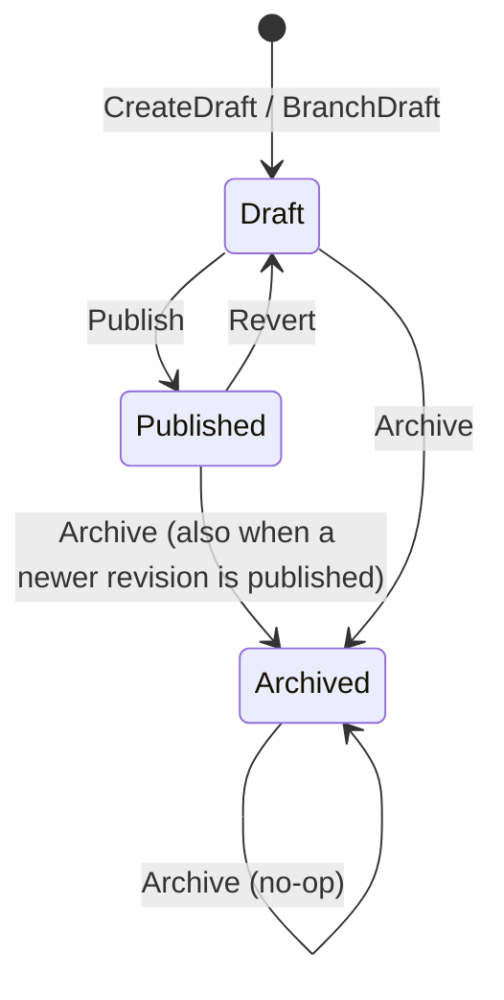

# LayoutComposition domain model

**Source:** `src/LayoutComposition/Domain/` (and the Application layer only where it shows publishing/consuming of integration events).

## Purpose

LayoutComposition owns layout chains (a named grid of camera tiles with a revision history) and walls (an ordered set of layouts, one of which is currently showing). It does not own overlay definitions or system-variable values: it consumes their integration events and relays them to kiosks through its SignalR broadcaster (`src/LayoutComposition/Domain/Layout/ILayoutLifecycleBroadcaster.cs:11`).

## Aggregates

### `Layout` (root of a layout chain)

Source: `src/LayoutComposition/Domain/Layout/Layout.cs:29`. Identifier: `LayoutIdentifier` (a Guid v7, `src/LayoutComposition/Domain/Layout/LayoutIdentifier.cs:13`). Owns a list of `Revision` sub-entities (`src/LayoutComposition/Domain/Layout/Layout.cs:31`). `Revision` is a plain class, not an aggregate root; it is identified by `LayoutRevisionIdentifier` and numbered by `LayoutRevisionNumber` (`src/LayoutComposition/Domain/Layout/Revision.cs:24`).

Revision lifecycle (state is the `LayoutRevisionState` value object with the three values Draft, Published, Archived, `src/LayoutComposition/Domain/Layout/LayoutRevisionState.cs:20`):

| Transition | Rule | Citation |
|---|---|---|
| new chain: Draft revision number 1 | `CreateDraft` adds the first revision as Draft; no event is raised | `src/LayoutComposition/Domain/Layout/Layout.cs:152` |
| new Draft branched off the chain | `BranchDraft` copies grid and tiles from the Published revision, else from the newest Archived revision when every revision is Archived; otherwise throws `InvalidOperationException` | `src/LayoutComposition/Domain/Layout/Layout.cs:179` |
| Draft to Published | only a Draft may be published | `src/LayoutComposition/Domain/Layout/Revision.cs:87` |
| previous Published revision to Archived on publish | `Publish` archives the prior Published sibling in the same call | `src/LayoutComposition/Domain/Layout/Layout.cs:233` |
| Published to Draft | only a Published revision may be reverted | `src/LayoutComposition/Domain/Layout/Revision.cs:98` |
| Draft or Published to Archived | archiving an Archived revision is a no-op | `src/LayoutComposition/Domain/Layout/Revision.cs:127` |
| editing grid and tiles | only a Draft is editable | `src/LayoutComposition/Domain/Layout/Revision.cs:115` |

Invariants:

- At most one revision per chain is Published. `Publish` archives the previous Published revision before raising the Published event (`src/LayoutComposition/Domain/Layout/Layout.cs:233`), and the lookup of the current Published revision uses `SingleOrDefault`, which throws if two exist (`src/LayoutComposition/Domain/Layout/Layout.cs:317`).
- A grid and tile set must satisfy four rules, checked by `Layout.ValidateGrid` and re-checked by the aggregate as a backstop that throws: at least one tile (`src/LayoutComposition/Domain/Layout/Layout.cs:76`), grid cells at most `GridDimensions.MaxCells` and tiles at most `GridDimensions.MaxTiles` (`src/LayoutComposition/Domain/Layout/Layout.cs:80`), every tile inside the grid (`src/LayoutComposition/Domain/Layout/Layout.cs:84`), no two tiles overlapping (`src/LayoutComposition/Domain/Layout/Layout.cs:92`). The backstop throw is at `src/LayoutComposition/Domain/Layout/Layout.cs:116`. `GridViolation` names the four outcomes.
- The backstop runs on create and on draft edit (`src/LayoutComposition/Domain/Layout/Layout.cs:142`, `src/LayoutComposition/Domain/Layout/Layout.cs:209`).
- The fab of a layout is set when the chain is created and has no setter (`src/LayoutComposition/Domain/Layout/Layout.cs:44`, `src/LayoutComposition/Domain/Layout/Layout.cs:148`).
- A Draft revision cannot be published twice or from another state, and a non-Draft revision cannot be edited (`src/LayoutComposition/Domain/Layout/Revision.cs:87`, `src/LayoutComposition/Domain/Layout/Revision.cs:115`). Illegal transitions throw `InvalidOperationException`.
- A revision number must exist in the chain, otherwise the aggregate throws (`src/LayoutComposition/Domain/Layout/Layout.cs:341`).
- The chain-level `ArchivedAt` marker is set only when every revision is Archived, keeps its earlier instant if already set, and is cleared otherwise (`src/LayoutComposition/Domain/Layout/Layout.cs:313`). It is restated by every mutator via `RecomputeArchival` (`src/LayoutComposition/Domain/Layout/Layout.cs:309`).
- Revisions copy their grid and tiles instead of sharing instances (`src/LayoutComposition/Domain/Layout/Revision.cs:58`, `src/LayoutComposition/Domain/Layout/Revision.cs:72`). The code comment gives the reason as an EF owned-entity constraint (`src/LayoutComposition/Domain/Layout/Revision.cs:59`).

Domain events raised: `LayoutRevisionPublishedDomainEvent` (`src/LayoutComposition/Domain/Layout/Layout.cs:235`) and `LayoutRevisionArchivedDomainEvent` (`src/LayoutComposition/Domain/Layout/Layout.cs:233`, `src/LayoutComposition/Domain/Layout/Layout.cs:251`, `src/LayoutComposition/Domain/Layout/Layout.cs:277`).

### `Wall`

Source: `src/LayoutComposition/Domain/Wall/Wall.cs:32`. Identifier: `WallIdentifier` (`src/LayoutComposition/Domain/Wall/WallIdentifier.cs:10`). State: fab, `WallName`, an ordered list of `LayoutIdentifier` scenes, the one currently `Showing`, a `SceneVersion`, `ShowingSince` and `Creation` (`src/LayoutComposition/Domain/Wall/Wall.cs:43`).

A wall has no status enum. Its only state change is moving `Showing`:

| Transition | Rule | Citation |
|---|---|---|
| created | `Showing` starts as the first scene, `SceneVersion` starts at `SceneVersion.Initial` | `src/LayoutComposition/Domain/Wall/Wall.cs:121` |
| scene set edited, showing scene still present | `Showing` and `SceneVersion` are unchanged; the edit is a no-op if the set is identical | `src/LayoutComposition/Domain/Wall/Wall.cs:143` |
| scene set edited, showing scene dropped | `Showing` moves to the new first scene, `SceneVersion` advances, cause is `Reconfigured` | `src/LayoutComposition/Domain/Wall/Wall.cs:156` |
| `SwitchTo` a named scene or the next one | `Showing` changes, `SceneVersion` advances, `ShowingSince` is restated | `src/LayoutComposition/Domain/Wall/Wall.cs:204` |
| `SwitchTo` to the scene already showing, or `Next` with nothing else publishable | no-op: nothing changes and nothing is raised | `src/LayoutComposition/Domain/Wall/Wall.cs:195` |

Invariants:

- A wall holds between `Wall.MinScenes` (2) and `Wall.MaxScenes` (8) scenes, without duplicates. `Wall.ValidateScenes` returns the first `SceneSetViolation` (`src/LayoutComposition/Domain/Wall/Wall.cs:70`, `src/LayoutComposition/Domain/Wall/Wall.cs:74`, `src/LayoutComposition/Domain/Wall/Wall.cs:78`); the aggregate throws if a caller skipped the check (`src/LayoutComposition/Domain/Wall/Wall.cs:90`). Constants: `src/LayoutComposition/Domain/Wall/Wall.cs:35`, `src/LayoutComposition/Domain/Wall/Wall.cs:38`.
- Create and edit both enforce the scene-set rule (`src/LayoutComposition/Domain/Wall/Wall.cs:111`, `src/LayoutComposition/Domain/Wall/Wall.cs:141`).
- A named switch target must be one of the wall's scenes and in the caller-supplied publishable set, otherwise `SwitchTo` throws (`src/LayoutComposition/Domain/Wall/Wall.cs:215`, `src/LayoutComposition/Domain/Wall/Wall.cs:219`).
- `Next` cycles through the ordered scenes, skipping any that are not publishable (`src/LayoutComposition/Domain/Wall/Wall.cs:237`).
- `SceneVersion` advances by exactly one per applied switch and never on a no-op (`src/LayoutComposition/Domain/Wall/Wall.cs:205`, `src/LayoutComposition/Domain/Wall/Wall.cs:195`).

The reason a switch happened is the `SceneSwitchCause` union: `Operator` (manual), `Rule` (an Automation rule, with a `RuleIdentifier` and a `CausingEventIdentifier`) and `Reconfigured` (the scene set edit dropped the showing scene) (`src/LayoutComposition/Domain/Wall/SceneSwitchCause.cs:17`, `src/LayoutComposition/Domain/Wall/SceneSwitchCause.cs:30`, `src/LayoutComposition/Domain/Wall/SceneSwitchCause.cs:37`). The request for a switch is the `SceneTarget` union: `Next` or `Layout` (a named scene) (`src/LayoutComposition/Domain/Wall/SceneTarget.cs:18`, `src/LayoutComposition/Domain/Wall/SceneTarget.cs:20`).

Domain events raised: `WallConfiguredDomainEvent` (`src/LayoutComposition/Domain/Wall/Wall.cs:126`, `src/LayoutComposition/Domain/Wall/Wall.cs:167`) and `WallSceneSwitchedDomainEvent` (`src/LayoutComposition/Domain/Wall/Wall.cs:163`, `src/LayoutComposition/Domain/Wall/Wall.cs:209`).

## Value objects

| Name | Wraps | Rule enforced | Citation |
|---|---|---|---|
| `LayoutIdentifier` | Guid | non-empty; `New()` mints Guid v7 | `src/LayoutComposition/Domain/Layout/LayoutIdentifier.cs:17` |
| `LayoutRevisionIdentifier` | Guid | non-empty; `New()` mints Guid v7 | `src/LayoutComposition/Domain/Layout/LayoutRevisionIdentifier.cs:17` |
| `WallIdentifier` | Guid | non-empty; `New()` mints Guid v7 | `src/LayoutComposition/Domain/Wall/WallIdentifier.cs:16` |
| `CameraIdentifier` | Guid | non-empty; this context's own copy, used by `Tile` | `src/LayoutComposition/Domain/Layout/CameraIdentifier.cs:17` |
| `OverlayIdentifier` | Guid | non-empty; this context's own copy, used by `Tile` | `src/LayoutComposition/Domain/Layout/OverlayIdentifier.cs:18` |
| `RuleIdentifier` | Guid | non-empty; this context's own copy of Automation's rule identifier (no cross-context reference) | `src/LayoutComposition/Domain/Wall/RuleIdentifier.cs:17` |
| `CausingEventIdentifier` | Guid | non-empty; correlation only, never dereferenced here | `src/LayoutComposition/Domain/Wall/CausingEventIdentifier.cs:16` |
| `FabIdentifier` | string | 2 to 32 characters, lowercase letters, digits or `-`, starting with a letter | `src/LayoutComposition/Domain/Layout/FabIdentifier.cs:79` |
| `LayoutName` | string | not blank, at most 80 characters, no line break; trimmed | `src/LayoutComposition/Domain/Layout/LayoutName.cs:19` |
| `WallName` | string | same rules as `LayoutName` | `src/LayoutComposition/Domain/Wall/WallName.cs:19` |
| `LayoutRevisionNumber` | int | at least 1; `Next()` increments | `src/LayoutComposition/Domain/Layout/LayoutRevisionNumber.cs:18` |
| `LayoutRevisionState` | string | only Draft, Published, Archived are accepted by `From` | `src/LayoutComposition/Domain/Layout/LayoutRevisionState.cs:32` |
| `GridDimensions` | rows, cols | each at least 1, rows times cols at most 9 | `src/LayoutComposition/Domain/Layout/GridDimensions.cs:39` |
| `GridPosition` | row, col | each at least 0 | `src/LayoutComposition/Domain/Layout/GridPosition.cs:17` |
| `TileSpan` | rows, cols | each at least 1 | `src/LayoutComposition/Domain/Layout/TileSpan.cs:26` |
| `Tile` | camera, optional overlay, position, span | holds a position and span; `Overlaps` tests rectangle intersection | `src/LayoutComposition/Domain/Layout/Tile.cs:115` |
| `SceneVersion` | long | at least 0; `Next()` increments | `src/LayoutComposition/Domain/Wall/SceneVersion.cs:34` |
| `ShowingSince` | DateTimeOffset | no validation | `src/LayoutComposition/Domain/Wall/ShowingSince.cs:12` |
| `CreatedAt`, `PublishedAt`, `ArchivedAt` | DateTimeOffset | `From` normalises to UTC | `src/LayoutComposition/Domain/Layout/CreatedAt.cs:36`, `src/LayoutComposition/Domain/Layout/PublishedAt.cs:36`, `src/LayoutComposition/Domain/Layout/ArchivedAt.cs:36` |
| `Creation` | `CreatedAt` plus `OperatorIdentifier` | the timestamp is not null | `src/LayoutComposition/Domain/Layout/Creation.cs:30` |

Enums used as results: `GridViolation` (Empty, Overlap, OutOfBounds, TooLarge; `src/LayoutComposition/Domain/Layout/GridViolation.cs:20`) and `SceneSetViolation` (TooFew, TooMany, Duplicate; `src/LayoutComposition/Domain/Wall/SceneSetViolation.cs:10`).

## Domain events

In-process only (ADR-0040).

| Event | Raised by | When | Citation |
|---|---|---|---|
| `LayoutRevisionPublishedDomainEvent` | `Layout` | a revision is published; carries grid and tiles | `src/LayoutComposition/Domain/Layout/Layout.cs:235` |
| `LayoutRevisionArchivedDomainEvent` | `Layout` | a previously Published revision is archived by a newer publish, reverted, or archived directly (not raised for archiving a Draft or an already Archived revision) | `src/LayoutComposition/Domain/Layout/Layout.cs:233`, `src/LayoutComposition/Domain/Layout/Layout.cs:251`, `src/LayoutComposition/Domain/Layout/Layout.cs:277` |
| `WallConfiguredDomainEvent` | `Wall` | the wall is created or its scene set changes (not when the set is identical) | `src/LayoutComposition/Domain/Wall/Wall.cs:126`, `src/LayoutComposition/Domain/Wall/Wall.cs:167` |
| `WallSceneSwitchedDomainEvent` | `Wall` | `Showing` actually changes (by switch, or by an edit that drops the showing scene) | `src/LayoutComposition/Domain/Wall/Wall.cs:163`, `src/LayoutComposition/Domain/Wall/Wall.cs:209` |

## Integration events

Each domain event above is translated to an integration event by an Application-layer handler.

### Published

| Event | Contract file | Publishing code |
|---|---|---|
| `LayoutRevisionPublishedV2` | `src/Shared.Contracts/LayoutComposition/LayoutRevisionPublishedV2.cs` | `src/LayoutComposition/Application/EventHandlers/LayoutRevisionPublishedDomainEventHandler.cs:38` |
| `LayoutRevisionArchivedV1` | `src/Shared.Contracts/LayoutComposition/LayoutRevisionArchivedV1.cs` | `src/LayoutComposition/Application/EventHandlers/LayoutRevisionArchivedDomainEventHandler.cs:27` |
| `WallConfiguredV1` | `src/Shared.Contracts/LayoutComposition/WallConfiguredV1.cs` | `src/LayoutComposition/Application/EventHandlers/WallConfiguredDomainEventHandler.cs:25` |
| `WallSceneChangedV1` | `src/Shared.Contracts/LayoutComposition/WallSceneChangedV1.cs` | `src/LayoutComposition/Application/EventHandlers/WallSceneSwitchedDomainEventHandler.cs:41` |

### Consumed

| Event | Contract file | Handler |
|---|---|---|
| `OverlayRevisionPublishedV3` (from OverlayDesigner) | `src/Shared.Contracts/OverlayDesigner/OverlayRevisionPublishedV3.cs` | `src/LayoutComposition/Application/EventHandlers/OverlayRevisionPublishedV3Handler.cs:25` |
| `OverlayRevisionArchivedV1` (from OverlayDesigner) | `src/Shared.Contracts/OverlayDesigner/OverlayRevisionArchivedV1.cs` | `src/LayoutComposition/Application/EventHandlers/OverlayRevisionArchivedV1Handler.cs:21` |
| `ResolvedOverlayTextChangedV3` (from SystemVariables) | `src/Shared.Contracts/SystemVariables/ResolvedOverlayTextChangedV3.cs` | `src/LayoutComposition/Application/EventHandlers/ResolvedOverlayTextChangedV3Handler.cs:24` |
| `OverlayHighlightRequestedV1` (published by Automation, `src/Automation/Application/EventHandlers/FabEventIngestedV1Handler.cs:180`) | `src/Shared.Contracts/LayoutComposition/OverlayHighlightRequestedV1.cs` | `src/LayoutComposition/Application/EventHandlers/OverlayHighlightRequestedV1Handler.cs:21` |
| `WallSceneSwitchRequestedV1` (published by Automation, `src/Automation/Application/EventHandlers/FabEventIngestedV1Handler.cs:196`) | `src/Shared.Contracts/LayoutComposition/WallSceneSwitchRequestedV1.cs` | `src/LayoutComposition/Application/EventHandlers/WallSceneSwitchRequestedV1Handler.cs:37` |
| `WallSceneChangedV1` (published by this context too) | `src/Shared.Contracts/LayoutComposition/WallSceneChangedV1.cs` | `src/LayoutComposition/Application/EventHandlers/WallSceneChangedV1Handler.cs:26` |

The first four consumed handlers relay onto the SignalR hub through `ILayoutLifecycleBroadcaster`; `WallSceneSwitchRequestedV1Handler` applies a switch to the `Wall`. Their roles are taken from the handlers' own doc comments (for example `src/LayoutComposition/Application/EventHandlers/WallSceneChangedV1Handler.cs:10`).

## Repositories and services

| Type | Promise | Citation |
|---|---|---|
| `ILayoutRepository` | Loads a layout by identifier within the fabs the caller holds, so another fab's layout and a missing one are indistinguishable; looks up by name within one fab; `Add` and `SaveAsync` | `src/LayoutComposition/Domain/Layout/ILayoutRepository.cs:26` |
| `IWallRepository` | Same fab-scoped conventions for walls: `FindAsync`, `FindByNameAsync`, `ListAsync`, `Add`, `SaveAsync`; `FindFabAsync` is unscoped and documented as never for a decision | `src/LayoutComposition/Domain/Wall/IWallRepository.cs:20` |
| `ILayoutPublicationLookup` | Cross-aggregate read for wall handlers: which candidate layouts are Published in a given fab, and which fab each candidate belongs to | `src/LayoutComposition/Domain/Wall/ILayoutPublicationLookup.cs:19` |
| `ILayoutLifecycleBroadcaster` | Port for pushing lifecycle frames (layout, overlay, resolved text, highlight, wall scene) to kiosks; its notification payloads are the records `LayoutRevisionPublishedNotification`, `LayoutRevisionArchivedNotification`, `OverlayLifecyclePublishedNotification`, `OverlayLifecycleElement`, `OverlayLifecycleArchivedNotification`, `ResolvedOverlayTextChangedNotification`, `ResolvedOverlayText`, `OverlayHighlightedNotification` and `WallSceneChangedNotification` | `src/LayoutComposition/Domain/Layout/ILayoutLifecycleBroadcaster.cs:11` |

There are no domain services.

## Omitted

- `LayoutRevisionPublishedNotification` — payload record of the broadcaster port, described with it above (`src/LayoutComposition/Domain/Layout/ILayoutLifecycleBroadcaster.cs:41`)
- `LayoutRevisionArchivedNotification` — payload record of the broadcaster port (`src/LayoutComposition/Domain/Layout/ILayoutLifecycleBroadcaster.cs:52`)
- `OverlayLifecyclePublishedNotification` — payload record of the broadcaster port (`src/LayoutComposition/Domain/Layout/ILayoutLifecycleBroadcaster.cs:70`)
- `OverlayLifecycleElement` — element record inside the overlay-published payload (`src/LayoutComposition/Domain/Layout/ILayoutLifecycleBroadcaster.cs:86`)
- `OverlayLifecycleArchivedNotification` — payload record of the broadcaster port (`src/LayoutComposition/Domain/Layout/ILayoutLifecycleBroadcaster.cs:100`)
- `ResolvedOverlayTextChangedNotification` — payload record of the broadcaster port (`src/LayoutComposition/Domain/Layout/ILayoutLifecycleBroadcaster.cs:128`)
- `ResolvedOverlayText` — template and resolved text pair inside the payload (`src/LayoutComposition/Domain/Layout/ILayoutLifecycleBroadcaster.cs:135`)
- `OverlayHighlightedNotification` — payload record of the broadcaster port (`src/LayoutComposition/Domain/Layout/ILayoutLifecycleBroadcaster.cs:150`)
- `WallSceneChangedNotification` — payload record of the broadcaster port (`src/LayoutComposition/Domain/Layout/ILayoutLifecycleBroadcaster.cs:163`)

## Questions

- Fab consistency of a wall's scenes (a scene layout in another fab, a scene that does not exist) is not enforced inside `Wall`; `ILayoutPublicationLookup.FabsOf` documents error codes `WALL_SCENE_NOT_FOUND` and `WALL_SCENE_OTHER_FAB` (`src/LayoutComposition/Domain/Wall/ILayoutPublicationLookup.cs:22`). The command handlers that apply it were not read for this page, so where it is enforced is not established here.
- `Layout` is documented as unable to change fab (no setter), but whether the Infrastructure mapping prevents it was not read.
- `WallSceneChangedV1` is both published and consumed by this context (`src/LayoutComposition/Application/EventHandlers/WallSceneSwitchedDomainEventHandler.cs:41`, `src/LayoutComposition/Application/EventHandlers/WallSceneChangedV1Handler.cs:26`). Whether other contexts also consume it, and whether any other context consumes `LayoutRevisionPublishedV2`, `LayoutRevisionArchivedV1` or `WallConfiguredV1`, was not classified on this page (only this context's Application layer was read).
- The Published and Archived domain-event handlers map `ArchivedBy`/`PublishedBy` to the contract; the contract field semantics (`Shared.Contracts`) were not read beyond file existence.
