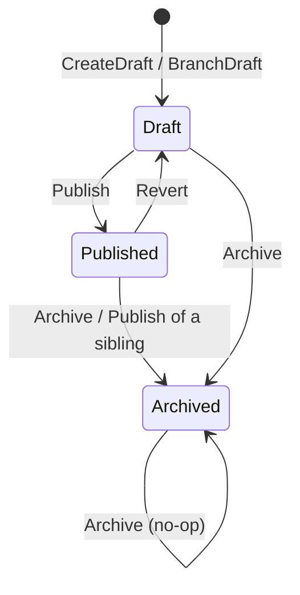

# OverlayDesigner domain model

**Source:** `src/OverlayDesigner/Domain/` (and the Application layer only where it shows publishing/consuming of integration events).

## Purpose

OverlayDesigner owns the authoring of overlays: a named chain of revisions, each holding an ordered set of at most eight elements (text, box, ellipse), and the publish/archive lifecycle of those revisions. It does not resolve variable placeholders in text, does not place overlays on walls, and consumes no integration events.

## Aggregates

### `Overlay` (root)

- **Identifier:** `OverlayIdentifier` (Guid v7, `src/OverlayDesigner/Domain/Overlay/OverlayIdentifier.cs:14`). Its child entity `Revision` is identified by `OverlayRevisionIdentifier` (`src/OverlayDesigner/Domain/Overlay/OverlayRevisionIdentifier.cs:12`) and ordered within the chain by `OverlayRevisionNumber`.
- **Shape (ADR-0104):** one logical chain holding 1..N `Revision`s; the class comment states "at most one Published at a time, branch-on-edit semantics" (`src/OverlayDesigner/Domain/Overlay/Overlay.cs:7`). `Revision` mutators are `internal`, so `Overlay` is the sole entry point (`src/OverlayDesigner/Domain/Overlay/Revision.cs:93`).
- **Chain state:** `Overlay.ArchivedAt` is `null` while any revision is live, and the instant the chain became fully archived otherwise (`src/OverlayDesigner/Domain/Overlay/Overlay.cs:248`).

#### Revision lifecycle

A revision's state is an `OverlayRevisionState` (`Draft`, `Published`, `Archived`; `src/OverlayDesigner/Domain/Overlay/OverlayRevisionState.cs:13`).

| Transition | Entry point | Rule | Citation |
|---|---|---|---|
| (none) -> Draft, number 1 | `Overlay.CreateDraft` | New chain; first revision is `OverlayRevisionNumber.One`. Raises no domain event. | `src/OverlayDesigner/Domain/Overlay/Overlay.cs:102` |
| (none) -> Draft, number max+1 | `Overlay.BranchDraft` | Branches from the Published revision, else from the newest revision when every revision is Archived; otherwise throws `InvalidOperationException`. Elements are copied. | `src/OverlayDesigner/Domain/Overlay/Overlay.cs:124` |
| Draft -> Published | `Overlay.Publish` -> `Revision.Publish` | Only a Draft may be published; any other state throws. | `src/OverlayDesigner/Domain/Overlay/Revision.cs:95` |
| Published -> Archived (sibling) | `Overlay.Publish` | The previously Published revision (if a different number) is archived in the same call, and an archived event is raised for it. | `src/OverlayDesigner/Domain/Overlay/Overlay.cs:169` |
| Published -> Draft | `Overlay.Revert` -> `Revision.Revert` | Only a Published revision may be reverted; `PublishedAt` is cleared. Raises the archived domain event "so connected kiosks treat the revision as gone". | `src/OverlayDesigner/Domain/Overlay/Revision.cs:106` |
| Draft or Published -> Archived | `Overlay.ArchiveRevision` -> `Revision.Archive` | Archived revisions are a no-op (idempotent); the archived event is raised only when the revision was Published. | `src/OverlayDesigner/Domain/Overlay/Overlay.cs:206` |
| Draft edit (no state change) | `Overlay.EditDraft` -> `Revision.ReplaceElements` | Replaces the whole element set; only a Draft may be edited. | `src/OverlayDesigner/Domain/Overlay/Revision.cs:125` |

Archived has no outgoing transition on a revision (`src/OverlayDesigner/Domain/Overlay/Revision.cs:134`). A fully archived chain is revived by `BranchDraft`, which adds a new Draft revision rather than changing the archived one (`src/OverlayDesigner/Domain/Overlay/Overlay.cs:124`).

#### Invariants

- A chain has at most one Published revision: `CurrentPublishedOrNull` uses `SingleOrDefault`, which throws if two exist (`src/OverlayDesigner/Domain/Overlay/Overlay.cs:255`), and `Publish` archives the prior Published revision before returning (`src/OverlayDesigner/Domain/Overlay/Overlay.cs:171`). The class comment also names a Postgres partial unique index as a backstop (`src/OverlayDesigner/Domain/Overlay/Overlay.cs:10`); that index is outside the Domain layer and was not read.
- An element set is non-empty: `ValidateElements` returns `ElementSetViolation.Empty` for zero elements (`src/OverlayDesigner/Domain/Overlay/Overlay.cs:46`).
- An element set has at most `OverlayElement.MaxElements` (8) elements: violation `ElementSetViolation.TooMany` (`src/OverlayDesigner/Domain/Overlay/Overlay.cs:50`; constant at `src/OverlayDesigner/Domain/Overlay/OverlayElement.cs:43`).
- The aggregate backstops those two rules by throwing `InvalidOperationException`, in `CreateDraft` and `EditDraft`, when a caller skipped `ValidateElements` (`src/OverlayDesigner/Domain/Overlay/Overlay.cs:72`, called at `src/OverlayDesigner/Domain/Overlay/Overlay.cs:93` and `src/OverlayDesigner/Domain/Overlay/Overlay.cs:149`).
- A revision must exist for any operation naming a revision number, else `InvalidOperationException` (`src/OverlayDesigner/Domain/Overlay/Overlay.cs:280`).
- A revision's elements carry dense zero-based ordinals reassigned from the given order, and are deep-copied on create, branch and replace (`src/OverlayDesigner/Domain/Overlay/Revision.cs:89`).
- A revision's `Elements` are always returned sorted by ordinal (`src/OverlayDesigner/Domain/Overlay/Revision.cs:35`).
- `Overlay.ArchivedAt` is recomputed on every mutator path; it is set only when all revisions are Archived and keeps an earlier instant on re-entry (`src/OverlayDesigner/Domain/Overlay/Overlay.cs:250`, `src/OverlayDesigner/Domain/Overlay/Overlay.cs:252`).
- `BranchDraft` is refused (throws) when the chain has a Draft and no Published revision and is not fully archived, so two competing drafts cannot arise from it (`src/OverlayDesigner/Domain/Overlay/Overlay.cs:270`).

Domain events raised: `OverlayRevisionPublishedDomainEvent` (`src/OverlayDesigner/Domain/Overlay/Overlay.cs:174`) and `OverlayRevisionArchivedDomainEvent` (`src/OverlayDesigner/Domain/Overlay/Overlay.cs:172`, `src/OverlayDesigner/Domain/Overlay/Overlay.cs:190`, `src/OverlayDesigner/Domain/Overlay/Overlay.cs:216`).

### `Revision` (child entity of `Overlay`)

Per-edit revision within the chain. Holds `Id` (`OverlayRevisionIdentifier`), `Number` (`OverlayRevisionNumber`), `State` (`OverlayRevisionState`), the elements, `Creation`, and optional `PublishedAt` / `ArchivedAt` (`src/OverlayDesigner/Domain/Overlay/Revision.cs:15`). It has no public mutators; its rules are listed in the lifecycle table above.

### `OverlayElement` (value object inside a revision)

Described under Value objects: it is an immutable record, not an entity with its own identifier.

## Value objects

| Name | Wraps | Rule enforced | Citation |
|---|---|---|---|
| `OverlayIdentifier` | `Guid` | Non-empty; `New()` mints Guid v7 | `src/OverlayDesigner/Domain/Overlay/OverlayIdentifier.cs:18` |
| `OverlayRevisionIdentifier` | `Guid` | Non-empty; `New()` mints Guid v7 | `src/OverlayDesigner/Domain/Overlay/OverlayRevisionIdentifier.cs:16` |
| `OverlayRevisionNumber` | `int` | At least 1; `Next()` adds 1 | `src/OverlayDesigner/Domain/Overlay/OverlayRevisionNumber.cs:16` |
| `OverlayRevisionState` | `string` | One of `Draft`, `Published`, `Archived`; `From` throws on anything else | `src/OverlayDesigner/Domain/Overlay/OverlayRevisionState.cs:25` |
| `OverlayName` | `string` | Not blank, at most 80 characters, no line break; trimmed | `src/OverlayDesigner/Domain/Overlay/OverlayName.cs:19` |
| `ElementKind` | `string` | One of `Text`, `Box`, `Ellipse`; `From` throws on anything else | `src/OverlayDesigner/Domain/Overlay/ElementKind.cs:27` |
| `ElementOrdinal` | `int` | At least 0 | `src/OverlayDesigner/Domain/Overlay/ElementOrdinal.cs:18` |
| `ElementSetViolation` | enum | `Empty` or `TooMany`; the result of `Overlay.ValidateElements`, not a stored value | `src/OverlayDesigner/Domain/Overlay/ElementSetViolation.cs:28` |
| `NormalizedPosition` | two `decimal` (X, Y) | Each in [0, 1] | `src/OverlayDesigner/Domain/Overlay/NormalizedPosition.cs:33` |
| `NormalizedSize` | two `decimal` (Width, Height) | Each in (0, 1] (exclusive at 0) | `src/OverlayDesigner/Domain/Overlay/NormalizedSize.cs:39` |
| `OverlayColor` | `string` | `#RRGGBB` or `#RRGGBBAA`, canonicalised to eight upper-case digits (alpha `FF` added); relative luminance must not exceed 0.35 | `src/OverlayDesigner/Domain/Overlay/OverlayColor.cs:54`, `src/OverlayDesigner/Domain/Overlay/OverlayColor.cs:58` |
| `TextContent` | `string` text + `int` font size (px) | Text not blank, at most 256 characters, trimmed; font size 8 to 256 | `src/OverlayDesigner/Domain/Overlay/TextContent.cs:29`, `src/OverlayDesigner/Domain/Overlay/TextContent.cs:33` |
| `OverlayElement` | `ElementKind`, `NormalizedPosition`, `NormalizedSize`, `OverlayColor`, optional `TextContent`, ordinal | Constructed only through three factories (`TextElement`, `Box`, `Ellipse`); a Text element must carry text and a non-Text element must not (`RequireConsistent`); a text element's colour must pass `TextLegibility.IsLegible`, else `ArgumentException` | `src/OverlayDesigner/Domain/Overlay/OverlayElement.cs:139`, `src/OverlayDesigner/Domain/Overlay/OverlayElement.cs:218` |
| `Creation` | `CreatedAt` + `OperatorIdentifier` | `CreatedAt` not null | `src/OverlayDesigner/Domain/Overlay/Creation.cs:30` |
| `CreatedAt`, `PublishedAt`, `ArchivedAt` | `DateTimeOffset` | Normalised to UTC; no further validation. Comparable. | `src/OverlayDesigner/Domain/Overlay/CreatedAt.cs:36`, `src/OverlayDesigner/Domain/Overlay/PublishedAt.cs:36`, `src/OverlayDesigner/Domain/Overlay/ArchivedAt.cs:36` |

`OperatorIdentifier` and `IClock` used above come from `Shared.Kernel` and are not Domain types of this context.

## Domain events

In-process only (ADR-0040).

| Event | Raised by | When | Citation |
|---|---|---|---|
| `OverlayRevisionPublishedDomainEvent` | `Overlay.Publish` | After a Draft becomes Published; carries overlay, revision number, name, the elements, time and operator | `src/OverlayDesigner/Domain/Overlay/Overlay.cs:174` |
| `OverlayRevisionArchivedDomainEvent` | `Overlay.Publish` | For the previously Published sibling archived by a publish | `src/OverlayDesigner/Domain/Overlay/Overlay.cs:172` |
| `OverlayRevisionArchivedDomainEvent` | `Overlay.Revert` | For the reverted revision | `src/OverlayDesigner/Domain/Overlay/Overlay.cs:190` |
| `OverlayRevisionArchivedDomainEvent` | `Overlay.ArchiveRevision` | Only when the archived revision was Published | `src/OverlayDesigner/Domain/Overlay/Overlay.cs:216` |

Declarations: `src/OverlayDesigner/Domain/Overlay/Events/OverlayRevisionPublishedDomainEvent.cs:12`, `src/OverlayDesigner/Domain/Overlay/Events/OverlayRevisionArchivedDomainEvent.cs:10`.

## Integration events

### Published

| Event | Contract | Publishing code |
|---|---|---|
| `OverlayRevisionPublishedV3` | `src/Shared.Contracts/OverlayDesigner/OverlayRevisionPublishedV3.cs` | `src/OverlayDesigner/Application/EventHandlers/OverlayRevisionPublishedDomainEventHandler.cs:31` (handler for `OverlayRevisionPublishedDomainEvent`, `Handle` at line 25) |
| `OverlayRevisionArchivedV1` | `src/Shared.Contracts/OverlayDesigner/OverlayRevisionArchivedV1.cs` | `src/OverlayDesigner/Application/EventHandlers/OverlayRevisionArchivedDomainEventHandler.cs:25` (handler for `OverlayRevisionArchivedDomainEvent`, `Handle` at line 19) |

Both are registered as durable outbox message types in `src/OverlayDesigner/Infrastructure/OverlayDesignerInfrastructureModule.cs:57`.

Consumers, found by reading each `Handle(...)` method (these are other contexts, listed for orientation):

| Event | Consumer handler |
|---|---|
| `OverlayRevisionPublishedV3` | `src/SystemVariables/Application/EventHandlers/OverlayRevisionPublishedV3Handler.cs:25`; `src/LayoutComposition/Application/EventHandlers/OverlayRevisionPublishedV3Handler.cs:25`; `src/AuditObservability/Application/EventHandlers/IntegrationEventAuditHandler.cs:50` |
| `OverlayRevisionArchivedV1` | `src/SystemVariables/Application/EventHandlers/OverlayRevisionArchivedV1Handler.cs:18`; `src/LayoutComposition/Application/EventHandlers/OverlayRevisionArchivedV1Handler.cs:21`; `src/AuditObservability/Application/EventHandlers/IntegrationEventAuditHandler.cs:49` |

### Consumed

None. No file under `src/OverlayDesigner` has a `Handle(...)` for an integration event; its only handlers are the two domain-event handlers above.

## Repositories and services

- `IOverlayRepository` (`src/OverlayDesigner/Domain/Overlay/IOverlayRepository.cs:10`): `GetByIdentifierAsync` and `GetByNameAsync` return `Option<Overlay>` (lines 12 and 14), `Add` registers a new aggregate (line 16) and `SaveAsync` commits (line 18).
- `TextLegibility` (static; `src/OverlayDesigner/Domain/Overlay/TextLegibility.cs:23`): a colour is legible when the better of its worst-case contrast over white and over black is at least 4.5 (`MinimumContrast`). `MinimumAlpha(color)` returns the smallest alpha at which the colour becomes legible (line 42) and throws if none exists.
- `RelativeLuminance` (static; `src/OverlayDesigner/Domain/Overlay/RelativeLuminance.cs:28`): sRGB relative luminance with weights 0.2126, 0.7152, 0.0722. `Of(OverlayColor)` guards null (line 14); the rest is `internal`.

## Omitted

None. Every Domain type of this context is named on this page.

## Questions

- `Overlay.cs:10` says a Postgres partial unique index backs the at-most-one-Published invariant, and `Overlay.cs:28` says another partial unique index makes the name rule unique among live chains. Neither lives in the Domain layer and neither was read here, so both are unverified by this page. Where the name uniqueness rule is enforced (`IOverlayRepository.GetByNameAsync` in the Domain, a handler, or the index) was not established.
- ADR-0104 (`docs/adr/0104-revisioned-aggregate-duplication.md:12`) states the revision lifecycle as `Draft -> Published -> Archived` and, in the same sentence, lists *revert* among the supported operations. The code implements revert as `Published -> Draft` (`src/OverlayDesigner/Domain/Overlay/Revision.cs:111`). That is consistent with the ADR's operation list, though the ADR's arrow notation does not draw the backward edge; no disagreement is claimed.
- Whether `OverlayRevisionState` and `ElementKind` should be enums instead of string records was not examined; they are string records in code.
