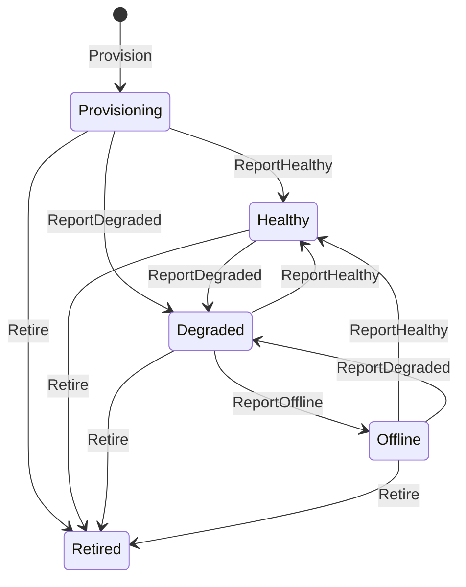

# StreamDistribution domain model

**Source:** `src/StreamDistribution/Domain/` (and the Application layer only where it shows publishing/consuming of integration events).

## Purpose

StreamDistribution owns one `Stream` per camera: the MediaMTX path that serves it, the RTSP source it pulls from and its health state. It does not own the camera record itself (CameraCatalog does) and, in this Domain layer, it only declares the gateway to MediaMTX as an interface; the HTTP calls live in Infrastructure.

## Aggregates

### `Stream`

- **Identifier:** `StreamIdentifier` (Guid v7 via `StreamIdentifier.New()`, `src/StreamDistribution/Domain/Stream/StreamIdentifier.cs:13`).
- **Root type:** `AggregateRoot<StreamIdentifier>` (`src/StreamDistribution/Domain/Stream/Stream.cs:27`).
- **State:** `Fab`, `Camera`, `Path`, `SourceUrl`, `State`, `TranscodeMode`, `LastSuccessAt`, `LastError`, `SourceChangedAt`, `SourceCameraVersion`, `Provisioning`, all with private setters (`src/StreamDistribution/Domain/Stream/Stream.cs:35`). `LastSuccessAt`, `LastError`, `SourceChangedAt` and `SourceCameraVersion` are nullable references, not `Option<T>` (class comment at `src/StreamDistribution/Domain/Stream/Stream.cs:16`).
- **Lifecycle:** five `StreamState` values. `Provision` starts a stream in `Provisioning` (`src/StreamDistribution/Domain/Stream/Stream.cs:94`).

| Behaviour | Transition | Raises | Citation |
|---|---|---|---|
| `Provision(...)` | new stream in `Provisioning`, `TranscodeMode.Unknown` | `StreamProvisionedDomainEvent` | `src/StreamDistribution/Domain/Stream/Stream.cs:74` |
| `ReportHealthy(mode, clock)` | any non-retired state to `Healthy` | `StreamHealthChangedDomainEvent`, only if the previous state was not `Healthy` | `src/StreamDistribution/Domain/Stream/Stream.cs:208` |
| `ReportDegraded(error, clock)` | any non-retired state to `Degraded` | `StreamHealthChangedDomainEvent`, only if the previous state was not `Degraded` | `src/StreamDistribution/Domain/Stream/Stream.cs:235` |
| `ReportOffline(error, clock)` | `Degraded` or `Offline` to `Offline` | `StreamHealthChangedDomainEvent`, only if the previous state was not `Offline` | `src/StreamDistribution/Domain/Stream/Stream.cs:260` |
| `Retire(clock)` | any state to `Retired` | `StreamHealthChangedDomainEvent` (first time only) | `src/StreamDistribution/Domain/Stream/Stream.cs:124` |
| `RepointTo(url, changedAt, cameraVersion, clock)` | no state change; replaces `SourceUrl` | none | `src/StreamDistribution/Domain/Stream/Stream.cs:176` |

**Invariants**

- The `Path` is derived from the camera identifier at provisioning (`cam-{guid}`), and `RepointTo` does not change it. `src/StreamDistribution/Domain/Stream/Stream.cs:85`
- A new stream starts in `Provisioning` with transcode mode `Unknown`. `src/StreamDistribution/Domain/Stream/Stream.cs:94`
- Provisioning requires a fab, a source URL and a clock; each is null-guarded. `src/StreamDistribution/Domain/Stream/Stream.cs:81`
- `Retired` is terminal: `ReportHealthy`, `ReportDegraded`, `ReportOffline` and `RepointTo` throw `InvalidOperationException` on a retired stream. `src/StreamDistribution/Domain/Stream/Stream.cs:308`
- `Retire` is idempotent: a second call returns without raising a second event. `src/StreamDistribution/Domain/Stream/Stream.cs:128`
- `Retire` clears `LastError`. `src/StreamDistribution/Domain/Stream/Stream.cs:136`
- A stream cannot go to `Offline` except from `Degraded` (or when already `Offline`); from `Provisioning` or `Healthy` the call throws. `src/StreamDistribution/Domain/Stream/Stream.cs:266`
- Reporting healthy records the detected transcode mode, stamps `LastSuccessAt` and clears `LastError`. `src/StreamDistribution/Domain/Stream/Stream.cs:217`
- Reporting degraded or offline stores the supplied `StreamError`. `src/StreamDistribution/Domain/Stream/Stream.cs:244`
- A health event is raised only when the state actually changes, never on a repeat report of the same state. `src/StreamDistribution/Domain/Stream/Stream.cs:222`
- `RepointTo` refuses a change older than the one recorded and returns `false`. When both carry a camera version, the lower version is older; otherwise `SourceChangedAt` is compared. `src/StreamDistribution/Domain/Stream/Stream.cs:187` and `src/StreamDistribution/Domain/Stream/Stream.cs:198`
- An applicable `RepointTo` records the stamp and version even when the URL is unchanged. `src/StreamDistribution/Domain/Stream/Stream.cs:192`

## Value objects

| Name | Wraps | Rule enforced | Citation |
|---|---|---|---|
| `StreamIdentifier` | `Guid` | must not be the empty Guid in `From` | `src/StreamDistribution/Domain/Stream/StreamIdentifier.cs:17` |
| `CameraIdentifier` | `Guid` | must not be the empty Guid in `From`; this context's own copy, value-copied across the boundary | `src/StreamDistribution/Domain/Stream/CameraIdentifier.cs:18` |
| `FabIdentifier` | `string` | 2 to 32 characters, lowercase letters, digits or `-`, starting with a letter | `src/StreamDistribution/Domain/Stream/FabIdentifier.cs:77` |
| `MediaMtxPath` | `string` | must match `cam-{guid}` in lowercase hex; `For(camera)` builds it | `src/StreamDistribution/Domain/Stream/MediaMtxPath.cs:24` |
| `StreamSourceUrl` | `string` | see below | `src/StreamDistribution/Domain/Stream/StreamSourceUrl.cs:75` |
| `StreamState` | `string` | closed set `Provisioning`, `Healthy`, `Degraded`, `Offline`, `Retired` | `src/StreamDistribution/Domain/Stream/StreamState.cs:37` |
| `TranscodeMode` | `string` | closed set `Passthrough`, `Software`, `Unknown` | `src/StreamDistribution/Domain/Stream/TranscodeMode.cs:19` |
| `StreamError` | `string` | `From`: not blank, at most 1024 characters; `Truncating`: not blank, clamps to 1024 | `src/StreamDistribution/Domain/Stream/StreamError.cs:30` |
| `LastSuccessAt` | `DateTimeOffset` | normalised to UTC | `src/StreamDistribution/Domain/Stream/LastSuccessAt.cs:36` |
| `ProvisionedAt` | `DateTimeOffset` | normalised to UTC | `src/StreamDistribution/Domain/Stream/ProvisionedAt.cs:36` |
| `SourceChangedAt` | `DateTimeOffset` | normalised to UTC | `src/StreamDistribution/Domain/Stream/SourceChangedAt.cs:38` |
| `SourceCameraVersion` | `int` | at least 0 | `src/StreamDistribution/Domain/Stream/SourceCameraVersion.cs:39` |
| `Provisioning` | `ProvisionedAt` + `OperatorIdentifier` (a Shared.Kernel type) | the timestamp must not be null | `src/StreamDistribution/Domain/Stream/Provisioning.cs:22` |
| `MediaMtxAction` | `string` | closed set `read`, `publish`, `playback`, `api` (the operation named in MediaMTX's external-auth hook body); `From` throws on other values, `TryFrom` returns `Option` | `src/StreamDistribution/Domain/Stream/MediaMtxAction.cs:32` |
| `ReportedMediaMtxAction` | `string` | evidence, not vocabulary: `From` clamps to 64 characters and replaces control, format and line/paragraph separator characters; it never rejects; `TryFrom` is `None` only for a null | `src/StreamDistribution/Domain/Stream/ReportedMediaMtxAction.cs:59` |

`StreamSourceUrl.From` (`src/StreamDistribution/Domain/Stream/StreamSourceUrl.cs:77`) requires a non-blank value of at most 2048 characters starting with `rtsp://` and with no `user:password@` segment (`src/StreamDistribution/Domain/Stream/StreamSourceUrl.cs:99`), and applies the same additional host, port, IPv6 and character checks as CameraCatalog's `RtspUrl` (`src/StreamDistribution/Domain/Stream/StreamSourceUrl.cs:78`). `StreamSourceUrl.FromStored` (`src/StreamDistribution/Domain/Stream/StreamSourceUrl.cs:93`) is the persistence-read path and applies only the base checks.

## Domain events

In-process only (ADR-0040).

| Event | Raised by | When | Citation |
|---|---|---|---|
| `StreamProvisionedDomainEvent` | `Stream.Provision` | a stream is provisioned | `src/StreamDistribution/Domain/Stream/Stream.cs:101` |
| `StreamHealthChangedDomainEvent` | `Stream.Retire` | first retirement | `src/StreamDistribution/Domain/Stream/Stream.cs:139` |
| `StreamHealthChangedDomainEvent` | `Stream.ReportHealthy` | state was not `Healthy` | `src/StreamDistribution/Domain/Stream/Stream.cs:224` |
| `StreamHealthChangedDomainEvent` | `Stream.ReportDegraded` | state was not `Degraded` | `src/StreamDistribution/Domain/Stream/Stream.cs:249` |
| `StreamHealthChangedDomainEvent` | `Stream.ReportOffline` | state was not `Offline` | `src/StreamDistribution/Domain/Stream/Stream.cs:279` |

`StreamProvisionedDomainEvent` has an in-process handler that only writes a log entry and publishes no integration event: `src/StreamDistribution/Application/EventHandlers/StreamProvisionedDomainEventHandler.cs:17`.

## Integration events

### Published

| Event | Contract file | Publishing code |
|---|---|---|
| `StreamHealthChangedV1` | `src/Shared.Contracts/StreamDistribution/StreamHealthChangedV1.cs` | `src/StreamDistribution/Application/EventHandlers/StreamHealthChangedDomainEventHandler.cs:60` (translates `StreamHealthChangedDomainEvent`, handler at line 22; a failed publish is recorded on a journey and rethrown, `src/StreamDistribution/Application/EventHandlers/StreamHealthChangedDomainEventHandler.cs:67`) |

Its only consumer found in `src/` is AuditObservability: `src/AuditObservability/Application/EventHandlers/IntegrationEventAuditHandler.cs:51`.

### Consumed

| Event | Contract file | Handler |
|---|---|---|
| `CameraRegisteredV1` | `src/Shared.Contracts/CameraCatalog/CameraRegisteredV1.cs` | `src/StreamDistribution/Application/EventHandlers/CameraRegisteredIntegrationEventHandler.cs:21` (issues `ProvisionStreamCommand`, line 50) |
| `CameraAddressChangedV1` | `src/Shared.Contracts/CameraCatalog/CameraAddressChangedV1.cs` | `src/StreamDistribution/Application/EventHandlers/CameraAddressChangedIntegrationEventHandler.cs:27` (issues `RepointStreamCommand`) |
| `CameraRetiredV1` | `src/Shared.Contracts/CameraCatalog/CameraRetiredV1.cs` | `src/StreamDistribution/Application/EventHandlers/CameraRetiredIntegrationEventHandler.cs:31` (issues `RetireStreamCommand`) |

## Repositories and services

- `IStreamRepository` (`src/StreamDistribution/Domain/Stream/IStreamRepository.cs:10`):
  - lookups returning `Option<Stream>` by identifier, by camera and by path (`src/StreamDistribution/Domain/Stream/IStreamRepository.cs:12`, `src/StreamDistribution/Domain/Stream/IStreamRepository.cs:14`, `src/StreamDistribution/Domain/Stream/IStreamRepository.cs:16`);
  - `Add` and `SaveAsync` (`src/StreamDistribution/Domain/Stream/IStreamRepository.cs:18`);
  - `IsUnchangedSinceLoadAsync`: a conditional no-op update that reports whether the row still carries the version this unit of work loaded, writing nothing (`src/StreamDistribution/Domain/Stream/IStreamRepository.cs:30`);
  - `ReadCommittedStateAsync`: the committed `StreamState`, read past the change tracker (`src/StreamDistribution/Domain/Stream/IStreamRepository.cs:36`).
- `IRtspGateway` (`src/StreamDistribution/Domain/Stream/IRtspGateway.cs:10`): the port to the media server.
  - `AddPathAsync` is idempotent on the path name; any other rejection throws `HttpRequestException` (`src/StreamDistribution/Domain/Stream/IRtspGateway.cs:27`).
  - `RemovePathAsync` (`src/StreamDistribution/Domain/Stream/IRtspGateway.cs:29`).
  - `RepointPathAsync` (`src/StreamDistribution/Domain/Stream/IRtspGateway.cs:44`).
  - `GetAllPathsHealthAsync` returns health for every reported path in one sweep; a path the server does not report is absent from the result, and a list that cannot be read to its end throws rather than returning a partial result (`src/StreamDistribution/Domain/Stream/IRtspGateway.cs:76`).
  - `ListConfiguredPathsAsync` and `ListConfiguredPathSourcesAsync` (`src/StreamDistribution/Domain/Stream/IRtspGateway.cs:84`, `src/StreamDistribution/Domain/Stream/IRtspGateway.cs:94`).
- `RtspPathHealth` is the data record `GetAllPathsHealthAsync` returns: readiness flag, last error text, last frame time and detected `TranscodeMode` (`src/StreamDistribution/Domain/Stream/IRtspGateway.cs:104`).

No domain services exist in this Domain layer.

## Omitted

None. Every Domain type is named above.

## Questions

- The class comment on `Stream` describes a "four-state machine (Provisioning to Healthy to Degraded to Offline + recovery edges)" (`src/StreamDistribution/Domain/Stream/Stream.cs:10`), while `StreamState` defines five values including `Retired` (`src/StreamDistribution/Domain/Stream/StreamState.cs:27`) and `Retire` is implemented (`src/StreamDistribution/Domain/Stream/Stream.cs:124`). This page follows the code.
- Which components call `ReportHealthy`, `ReportDegraded` and `ReportOffline` (the health watcher in Infrastructure, `src/StreamDistribution/Infrastructure/HealthWatcher/StreamHealthWatcher.cs`) and how often was not read in detail and is not described here.
- `MediaMtxAction` and `ReportedMediaMtxAction` are used by the external-auth hook (comments at `src/StreamDistribution/Domain/Stream/MediaMtxAction.cs:6` and `src/StreamDistribution/Domain/Stream/ReportedMediaMtxAction.cs:8`), not by the `Stream` aggregate; where the hook lives and which context it belongs to was not established.
